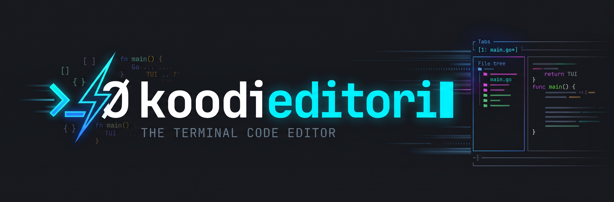

# Koodieditori



**Koodieditori** is a lightweight, high-performance, keyboard-driven Terminal User Interface (TUI) code editor engineered specifically for Linux tiling environments (Wayland / Niri) and built from the ground up for seamless pairing with **autonomous CLI coding agents** (e.g. Antigravity CLI, Claude Code, Aider).

Written in **pure Go** using the Elm architecture (Bubble Tea + Lip Gloss), Koodieditori delivers instantaneous startup (<20ms), robust Tree-sitter syntax highlighting, rich language ergonomics for Go, C/C++, Java, Markdown, JSON, TOML, YAML, XML, Bash, Zsh, Makefile, and CMake, and an extensible Unix Domain Socket IPC API without web runtime bloat (zero Electron, zero Node.js, zero WebAssembly).

---

> [!TIP]
> For the complete, unabridged operational guide and printable quick reference card, see the **[Comprehensive User Manual](docs/USER_MANUAL.md)**.

## Table of Contents

1. [Key Highlights](#key-highlights)
2. [Installation & Building](#installation--building)
3. [Quick Start](#quick-start)
4. [Editing Philosophy: Selection-First (`Object -> Action`)](#editing-philosophy-selection-first-object---action)
5. [Nordic Ergonomics & Semantic Text Objects](#nordic-ergonomics--semantic-text-objects)
6. [Keybindings & Cheat Sheet](#keybindings--cheat-sheet)
   - [Normal Mode Navigation](#normal-mode-navigation)
   - [Select Mode (Actions on Text)](#select-mode-actions-on-text)
   - [Leader Chords (`Space` + `<key>`)](#leader-chords-space--key)
   - [In-Buffer & Project Search & Replace Engine](#in-buffer--project-search-and-search-replace-engine)
   - [Built-in Native LSP Client (Go, C/C++, Java, Bash/Zsh, JSON, YAML, TOML, XML, CMake)](#built-in-native-lsp-client-go-cc-java-bashzsh-json-yaml-toml-xml-cmake)
   - [Interactive Debugger & DAP (Go, C/C++, Java)](#interactive-debugger--dap-go-cc-java)
   - [File Tree Explorer & Project Navigation](#file-tree-explorer--project-navigation)
   - [Fuzzy Finder Modal (`Space f f`, `Space b b`, `Space f g`)](#fuzzy-finder-modal)
   - [Ephemeral Output Drawer & Quickfix](#ephemeral-output-drawer--quickfix)
   - [Markdown & Mermaid Diagram Engine](#markdown--mermaid-diagram-engine)
   - [Autonomous Agent Coexistence & Diff Review](#autonomous-agent-coexistence--diff-review)
7. [Mouse & Touchpad Gestures](#mouse--touchpad-gestures)
8. [Scripting & Agent Automation (`koodi-cli`)](#scripting--agent-automation-koodi-cli)
9. [Configuration Reference (`config.toml`)](#configuration-reference-configtoml)
10. [Architecture & Contributing](#architecture--contributing)

---

## Key Highlights

- **Selection-First Modal Editing:** Visual certainty before mutation. Movement automatically highlights target text (`w` selects word forward, `b` selects word backward, `x` selects line), followed by actions (`d` delete, `c` change, `y` yank).
- **Nordic / Scandinavian Laptop-First Ergonomics:** Eliminates awkward `AltGr` combinations (`[`, `]`, `{`, `}`, `\`, `|`) and dead keys (`~`, `` ` ``) for everyday navigation. Text objects use clean alphanumeric mnemonics (`m i b` for block, `m i a` for array, `m i f` for function).
- **First-Class Agentic CLI Pairing:**
  - **Inotify Reconciliation:** Automatically detects background modifications by agents on disk. Clean buffers hot-reload instantaneously; dirty buffers trigger visual diff warnings without data loss.
  - **Agent Transaction Review (`Space d s`):** Groups multi-file agent bursts into a unified review session with batch accept (`Space d a`) or revert (`Space d r`).
  - **Unix Domain Socket IPC (`koodi-cli`):** Script the editor from any external shell tool or agent over local Unix sockets.
- **Zero-Space-Waste Display:** No cramped, permanent terminal splits. 100% of screen real estate is reserved for code, with an **Ephemeral Output Drawer (`Space o`)** that pops open for build outputs and collapses on `Esc` or `q`.
- **Built-in Hardcore Polyglot Tooling (Go, C/C++, Java, Bash/Zsh, JSON, TOML, YAML, XML, Make, CMake):**
  - Instant syntax highlighting (Tree-sitter AST & Chroma high-speed lexers) and semantic text objects.
  - Compiler and linter error regex parser (GCC, Clang, Javac, Go, ShellCheck, CMake, Make, yamllint, xmllint) with jump-to-source on `Enter`.
  - C++ Header $\leftrightarrow$ Source toggle (`Space a` / `Alt+o`).
  - Cross-file location Jumplist (`Ctrl+o` / `Ctrl+i`).
- **Terminal Markdown & Mermaid (Zero Web Tech):**
  - In-buffer syntax visual concealment and interactive checkboxes (`☐` / `☑`).
  - Ephemeral preview drawer powered by Glamour.
  - Mermaid diagrams rendered as clean Unicode box-art (universal) or high-resolution graphic cells via the Kitty Graphics Protocol in Wayland terminals (Foot, Kitty, WezTerm).
- **Interactive Source Debugger (DAP for Go, C/C++, Java):** Native JSON-RPC Debug Adapter Protocol client. Red `●` gutter breakpoints, paused `▶` execution indicators, interactive gutter clicks, variable/callstack inspector drawer (`Space d v`), and dual Space-chord / Function-key stepping controls (`F5`, `F9`..`F11`).
- **Interactive Help Cheatsheet & Command Palette (`?` / `F1` / `Space ?` / `Space h`):** Centered floating cheatsheet modal with real-time keyword filtering across all commands, text objects, and leader chords, instant action execution on `Enter`, and single-key dismissal (`Esc`, `q`, `?`).
- **Laptop Mouse & Touchpad Support:** Automatic visual buffer scrollbar with interactive click-to-jump and drag scrubbing, smooth two-finger scrolling, click-positioning, drag-selection, and border drag-to-resize.

---

## Installation & Building

### Prerequisites

- **Go 1.22+**
- **GCC / Clang** (for Tree-sitter CGo parsers)
- **Linux** (optimized for Wayland compositors like Niri, Sway, Hyprland)

### Building from Source

Clone the repository and build the binaries:

```bash
git clone git@github.com:mikolas/koodieditori.git
cd koodieditori

# Build both the editor and the companion CLI into bin/
make build
```

### Installing into PATH

Install the binaries into your `$GOPATH/bin` or `~/.local/bin`:

```bash
go install ./cmd/koodi ./cmd/koodi-cli
```

Make sure `~/.local/bin` or `$GOPATH/bin` is in your `$PATH`.

---

## Quick Start

Open single or multiple files:

```bash
# Open one file
koodi main.go

# Open multiple files into buffer tabs
koodi src/main.cpp include/main.hpp README.md

# Open an empty buffer
koodi
```

### Interface Overview

```text
┌────────────────────────────────────────────────────────────────────────┐
│ [1: main.go*]  [2: engine.cpp]  [3: README.md]                         │ ← Bufferline Tabs
├────────────────────────────────────────────────────────────────────────┤
│   1   package main                                                     │
│   2                                                                    │
│   3   func main() {                                                    │ ← Code Viewport
│   4 ▶     fmt.Println("Hello, Koodi!")                                 │   (with 6-col Gutter)
│   5   }                                                                │
├────────────────────────────────────────────────────────────────────────┤
│ ──── Output & Diagnostics (Esc/q to close, Enter to jump) ──────────── │ ← Ephemeral Drawer
│ ▶ gcc:4:5: error: undefined reference to 'foo'                         │   (Slides up on demand)
├────────────────────────────────────────────────────────────────────────┤
│ NORMAL  main.go*  Go  Ln 4, Col 5  12 lines  [Agent: Idle]             │ ← Statusline
└────────────────────────────────────────────────────────────────────────┘
```

---

## Editing Philosophy: Selection-First (`Object -> Action`)

Unlike traditional Vim (`Verb -> Object`, e.g. `d w` to delete word where you cannot see what will be deleted until it happens), Koodieditori adopts a **Selection-First** paradigm (similar to Kakoune and Helix):

1. **Select First:** Navigate or expand selection. The target text is immediately highlighted.
2. **Act Second:** Execute the operation (`d` delete, `c` change, `y` yank, `>` indent).

```text
       ┌───────────┐      [i / a]       ┌───────────┐
       │  NORMAL   │ ─────────────────> │   MATCH   │
       └─────┬─────┘                    └─────┬─────┘
             │                                │
             │ [w / b / x / mouse drag]       │ [b / a / p / q / f / c]
             ▼                                ▼
       ┌───────────┐                    ┌───────────┐
       │  SELECT   │ <──────────────────┤  SELECT   │
       └─────┬─────┘                    └───────────┘
             │
             │ [d / y / > / < / Esc] ──> NORMAL
             │ [c / Enter]           ──> INSERT
             ▼
       ┌───────────┐      [Esc / jk]    ┌───────────┐
       │  INSERT   │ ─────────────────> │  NORMAL   │
       └───────────┘                    └───────────┘
```

---

## Nordic Ergonomics & Semantic Text Objects

Standard US-centric editor keybindings heavily rely on braces `{`, `}`, brackets `[`, `]`, pipes `|`, and backticks `` ` ``, which require cumbersome `AltGr` chords or dead keys on Scandinavian / Nordic ISO keyboards.

In Koodieditori, press **`m`** (Match) in `NORMAL` mode, followed by **`i`** (inside) or **`a`** (around), then a mnemonic letter:

| Key Chord | Targeted Semantic Region | Traditional Equivalent |
| :--- | :--- | :--- |
| **`m i b`** / **`m a b`** | Inside / Around **Block** `{ ... }` | `i{` / `a{` |
| **`m i a`** / **`m a a`** | Inside / Around **Array** `[ ... ]` | `i[` / `a[` |
| **`m i p`** / **`m a p`** | Inside / Around **Parentheses** `( ... )` | `i(` / `a(` |
| **`m i q`** / **`m a q`** | Inside / Around **Quote** (`"..."`, `'...'`, `` `...` ``) | `i"` / `a"` |
| **`m i f`** / **`m a f`** | Inside / Around **Function Definition** (Tree-sitter) | AST node |
| **`m i c`** / **`m a c`** | Inside / Around **Class / Struct / Interface** | AST node |

After selecting an object, you are automatically in `SELECT` mode. Press `d` to delete, `c` to replace, `y` to copy, or `Esc` to cancel.

---

## Keybindings & Cheat Sheet

### Normal Mode Navigation

| Key | Action |
| :--- | :--- |
| `h` / `Left` | Move cursor left 1 column |
| `l` / `Right` | Move cursor right 1 column |
| `k` / `Up` | Move cursor up 1 row |
| `j` / `Down` | Move cursor down 1 row |
| `w` | Select word forward (enters `SELECT` mode) |
| `b` | Select word backward (enters `SELECT` mode) |
| `x` | Select entire line (enters `SELECT` mode) |
| `Home` / `0` | Move to start of line |
| `End` / `$` | Move to end of line |
| `PgUp` / `PgDown` | Scroll viewport up / down by one page |
| `Ctrl+Home` | Jump to beginning of buffer |
| `Ctrl+End` | Jump to end of buffer |
| `Alt+Left` / `Alt+Right` | Move word backward / forward without selecting |
| `i` | Enter `INSERT` mode at cursor |
| `a` | Enter `INSERT` mode after cursor |
| `Ctrl+S` | Save current buffer atomically (tempfile + fsync + rename) |
| `u` | Undo last transaction |
| `U` | Redo last transaction |
| `d` | Delete character under cursor |
| `y` | Yank (copy) character under cursor |
| `p` / `P` | Paste clipboard content after / before cursor |
| `ö` / `ä` | Step backward / forward between LSP diagnostics (or diff hunks) |
| `H` / `L` | Switch to previous / next buffer tab |
| `Alt+1` .. `Alt+9` | Switch directly to buffer tab 1 through 9 |
| `Ctrl+o` | Jump backward in Jumplist history |
| `Ctrl+i` | Jump forward in Jumplist history |
| `?` / `F1` | Open interactive Help & Keybindings cheatsheet modal |

### Select Mode (Actions on Text)

| Key | Action |
| :--- | :--- |
| `d` | Delete selection (copies to yank register), returns to `NORMAL` |
| `c` | Change selection (deletes and enters `INSERT` mode) |
| `y` | Yank selection to register and clipboard, returns to `NORMAL` |
| `>` / `<` | Indent / outdent selected lines by `tab_width` |
| `!` | Pipe selection through an external shell command |
| `h` / `j` / `k` / `l` | Extend selection boundaries |
| `w` / `b` | Extend selection by word forward / backward |
| `Esc` | Collapse selection back to cursor |

### Leader Chords (`Space` + `<key>`)

Press `Space` to initiate a leader chord (timeout: 2000ms):

| Leader Chord | Category | Action |
| :--- | :--- | :--- |
| `Space f s` | Buffer | **Save** active buffer atomically (tempfile + fsync + rename) |
| `Space f a` | Buffer | **Save All** modified buffers atomically |
| `Space b d` | Buffer | Close current buffer (prompts warning if unsaved edits) |
| `Space b D` | Buffer | **Force Close** current buffer (discards unsaved edits) |
| `Space e` | Layout | Toggle **File Tree** sidebar open / close |
| `Space f f` | Navigation | Open **Fuzzy File Finder** modal |
| `Space b b` | Navigation | Open **Buffer Switcher** fuzzy finder |
| `Space f g` | Navigation | Open **Live Grep** ripgrep search modal |
| `Space o` | Layout | Toggle Ephemeral Output Drawer open / close |
| `Space a` | Tooling | Switch C++ alternate file (`.cpp` $\leftrightarrow$ `.hpp`) |
| `Space ?` / `Space h` | Navigation | Open interactive **Help & Keybindings** modal |
| `Space g d` | LSP | **Go to Definition** (recorded in Jumplist, `Ctrl+o` jumps back) |
| `Space g i` | LSP | **Go to Implementation** (interfaces & polymorphism) |
| `Space g c` | LSP | **Call Hierarchy** |
| `Space k` / `K` | LSP | **Hover Documentation** popover |
| `Space c a` | LSP | Open **Code Actions** menu |
| `Space c r` | LSP | **Rename Symbol** across open workspace |
| `Space n d` | LSP | Jump to **Next** LSP diagnostic (Error / Warning) |
| `Space p d` | LSP | Jump to **Previous** LSP diagnostic |
| `Space n h` | Diff | Jump to **Next** diff hunk in buffer |
| `Space p h` | Diff | Jump to **Previous** diff hunk in buffer |
| `Space n e` | Diagnostics | Jump to **Next** compiler/build error in workspace |
| `Space s r` | Search | Open interactive **Search & Replace** drawer for current buffer |
| `Space s p` | Search | Open interactive **Project-wide Search & Replace** drawer |
| `Space c h` | Search | Clear active search highlights |
| `Space n s` / `n` | Search | Jump to **Next** search match |
| `Space p s` / `N` | Search | Jump to **Previous** search match |
| `Space m p` | Markdown | Toggle Markdown & Mermaid live preview drawer |
| `Space m t` | Markdown | Toggle checklist task checkbox under cursor (`- [ ]` $\leftrightarrow$ `- [x]`) |
| `Space m d` | Markdown | Toggle Mermaid diagram mode (Box-art $\leftrightarrow$ Kitty graphics) |
| `Space d b` / `F9` | Debugger | **Toggle Breakpoint** on active line |
| `Space d c` / `F5` | Debugger | **Start / Continue** execution |
| `Space d n` / `F10` | Debugger | **Step Over** line |
| `Space d i` / `F11` | Debugger | **Step Into** function |
| `Space d o` / `Shift+F11` | Debugger | **Step Out** of function |
| `Space d p` | Debugger | **Pause** running debug target |
| `Space d q` / `Shift+F5` | Debugger | **Stop / Disconnect** debugger session |
| `Space d v` | Debugger | Toggle **Debug Inspector Drawer** (Stack & Variables) |
| `Space d s` | Agent | Open Agent Batch Transaction Review drawer |
| `Space d a` | Agent | **Accept All** changes in pending agent transaction |
| `Space d r` | Agent | **Revert All** changes in pending agent transaction back to disk |
| `Space w >` | Layout | Grow File Tree sidebar width (+3 cols) |
| `Space w <` | Layout | Shrink File Tree sidebar width (-3 cols) |
| `Space w +` | Layout | Grow Output Drawer height (+3 rows) |
| `Space w -` | Layout | Shrink Output Drawer height (-3 rows) |
| `Ctrl+Space` | Insert | Trigger **Autocomplete** suggestion popover |

---

### In-Buffer & Project Search and Search-Replace Engine

Koodieditori features a fast, responsive, and ergonomic search and replace engine designed for keyboard-driven workflows:

- **Interactive In-Buffer Search (`/`):**
  - Instant statusline prompt (`/ query█`) with real-time match count `[X matches]`.
  - Live viewport highlights as you type; active match styled with `SearchCurrent` and other matches with `SearchMatch`.
  - Press `Enter` to confirm, or `Esc` to cancel.
  - Navigate matches in `NORMAL` mode with `n` (next) / `N` (previous) or Nordic leader chords `Space n s` / `Space p s`.
  - Clear highlights at any time with `Space c h`.

- **Interactive Search & Replace Drawer (`Space s r` / `Space s p`):**
  - Ephemeral bottom drawer displaying **Find** and **Replace** fields, flag statuses, match counts, and a live **Before/After Diff Preview** (`- old` / `+ new`).
  - `Tab` / `Shift+Tab`: Cycle focus between Find and Replace fields.
  - `Alt+c`: Toggle case sensitivity.
  - `Alt+w`: Toggle whole word matching.
  - `Alt+r`: Toggle regex search with back-references (`$1`, `$2`, `\1`, `\2`).
  - `Alt+y`: Replace current match at cursor and advance to next.
  - `Enter` or `Alt+a`: Replace all matches atomically with single-step undo (`u`).
  - `Esc`: Dismiss the drawer immediately.

---

### Built-in Native LSP Client (Go, C/C++, Java, Bash/Zsh, JSON, YAML, TOML, XML, CMake)

Koodieditori features a zero-dependency, pure Go **JSON-RPC 2.0 Language Server Protocol (LSP)** client. Language servers run asynchronously over standard I/O in the background with zero TUI stutter:

- **Auto-Discovery & Root Detection:**
  - **Go (`gopls`):** Automatically locates `go.mod` root directory.
  - **C / C++ (`clangd`):** Automatically detects `compile_commands.json` or `CMakeLists.txt`.
  - **Java (`jdtls`):** Detects `pom.xml` / `build.gradle` and auto-provisions isolated cache folders under `~/.cache/koodi/jdtls/<hash>`.
  - **Shell (`bash-language-server`):** Automatic ShellCheck diagnostics and completion for Bash and Zsh.
  - **Config Formats (`vscode-json-language-server`, `yaml-language-server`, `taplo`, `lemminx`):** Schema validation, auto-completions, and linting for JSON, YAML, TOML, and XML.
  - **CMake (`cmake-language-server`):** Command completions and argument signature documentation.
- **Diagnostics in Gutter & Statusline:**
  - `Col 1` of gutter displays `E` (Bright Red) for errors, `W` (Yellow) for warnings, `I` (Blue) for information.
  - Tabs in the top bufferline display `!%d` warning badges if issues exist.
  - Statusline displays total buffer errors/warnings: `E:1 W:3` alongside language server status `[gopls: ok]`.
  - Diagnostic stepping via `Space n d` / `Space p d` moves the cursor and displays the diagnostic message in the status bar.
- **Floating Autocomplete Popover (`Ctrl+Space` or typing):**
  - Instant suggestion list with category badges: `[fn]` functions, `[var]` variables, `[type]` structs/interfaces, `[const]` constants.
  - Navigate with `Down` / `Up` (or `Ctrl+n` / `Ctrl+p`), confirm with `Tab` or `Enter`, dismiss with `Esc`.
  - Automatically replaces typed prefix or applies LSP `TextEdit` inside an undo transaction.
- **Hover Documentation Tooltip (`K` or `Space k`):**
  - Displays function signatures and Markdown documentation in an ephemeral popover.
  - Dismisses instantly with `Esc` or `q`.
- **Code Actions (`Space c a`) & Rename (`Space c r`):**
  - Quickfix actions (imports, unused variables) displayed in a floating numbered menu; press `1..9` or `Enter` to apply.
  - Workspace-wide symbol rename executes atomic piece table transactions across all open buffers.

---

### Interactive Debugger & DAP (Go, C/C++, Java)

Koodieditori integrates a built-in **Debug Adapter Protocol (DAP)** client, allowing full interactive debugging inside the terminal without external IDE dependencies:

- **Multi-Language Adapter Support:**
  - **Go:** Automatically launches Delve in DAP mode (`dlv dap`).
  - **C / C++:** Connects seamlessly to LLDB DAP (`lldb-dap`, `lldb-vscode`, or `gdb -i=dap`).
  - **Java:** Connects to Java Debug Server (`java-debug` / Eclipse JDT.LS debugger plugin).
  - Fully customizable via `[dap.adapters.<lang>]` in `config.toml`.
- **Gutter Indicators & Breakpoints:**
  - **`●` (Bright Red):** Set on active breakpoint lines in Gutter Column 1.
  - **`▶` (Bright Yellow/Green):** Indicates current execution line when execution is paused.
  - Viewport auto-scrolls to ensure the paused frame remains centered in view.
  - Click directly on Gutter `Col 1` with your mouse or press `Space d b` / `F9` to toggle a breakpoint on the target line.
- **Ephemeral Debug Inspector Drawer (`Space d v`):**
  - Displays the active debug session state: `[STOPPED: breakpoint]` or `[RUNNING]`.
  - **Call Stack:** Frame hierarchy (`#0 main() at main.go:42`).
  - **Scopes & Variables:** Live view of local and global variables formatted as `name = value (type)`.
  - **Console Output:** Real-time stdout/stderr output from the debugged process.
- **Dual Ergonomic Controls (Function Keys & Nordic Chords):**
  - `Space d b` / `F9`: Toggle Breakpoint
  - `Space d c` / `F5`: Start / Continue Execution
  - `Space d n` / `F10`: Step Over
  - `Space d i` / `F11`: Step Into
  - `Space d o` / `Shift+F11`: Step Out
  - `Space d p`: Pause Execution
  - `Space d q` / `Shift+F5`: Stop / Disconnect Debugger
  - `Space d v`: Toggle Debug Inspector Drawer

---

### File Tree Explorer & Project Navigation

The left-docked File Tree sidebar (`Space e`) provides fast, visual workspace browsing with full keyboard and mouse control:

- **Smart Explorer Toggle (`Space e`):**
  - If tree is closed: Opens the sidebar and **immediately focuses it** (`TREE` mode).
  - If tree is open and focused: Closes the sidebar and returns focus to the Code Buffer (`NORMAL` mode).
  - If tree is open but unfocused: Shifts keyboard focus to the tree (`TREE` mode) without closing it.
- **Keyboard Navigation (in `TREE` mode):**
  - **`j` / `k` (or `Down` / `Up`):** Move cursor line-by-line through the project tree.
  - **`Enter` / `l` / `Right`:**
    - On a **directory:** Toggles expansion (`▸` $\leftrightarrow$ `▾`).
    - On a **file:** Opens the file in an active buffer tab and **transfers focus to the Code Buffer** (`NORMAL` mode).
  - **`h` / `Left`:** Collapses the current directory; if already collapsed or on a file, jumps cursor to the parent directory.
  - **`g g` / `Home`:** Jump directly to the top of the tree.
  - **`G` / `End`:** Jump directly to the bottom of the tree.
  - **`Ctrl+d` / `Ctrl+u` (or `PgDown` / `PgUp`):** Scroll tree by half-page.
  - **`r`:** Re-scan and refresh directory contents and git status flags.
  - **`a` / `A`:** Interactive statusline prompt to create a new file (`a` $\to$ `New File: █`, auto-opens in buffer) or new directory (`A` $\to$ `New Folder: █`, auto-expands parent folder and selects the new directory) inside the selected folder (`Enter` to confirm, `Esc` to cancel).
  - **`d`:** Delete the selected file or directory from disk (requires pressing `d` twice within 3 seconds for safety confirmation).
  - **`Esc` / `q`:** Return keyboard focus to the active Code Buffer without closing the tree.
- **Pane & Window Focus Cycling:**
  - **`Ctrl+w`** (or **`Space w w`**): Cycle focus between active panes:
    $$\text{Code Buffer} \longrightarrow \text{Output Drawer (if open)} \longrightarrow \text{File Tree} \longrightarrow \text{Code Buffer}$$
  - **`Space w h`:** Focus left pane (File Tree).
  - **`Space w l`:** Focus right pane (Code Buffer).
  - **`Space w j`:** Focus bottom pane (Output / Markdown Drawer).
- **Git Status Indicators:** Columns display live git status badges:
  - `M` (Modified - Yellow)
  - `A` (Added - Green)
  - `U` (Untracked - Cyan)
  - `D` (Deleted - Red)
- **Width Resizing:** Dynamically resize the tree width using `Space w >` (+3 cols) / `Space w <` (-3 cols), or simply click and drag the vertical border (`│`) with your mouse.
- **Inotify Live Sync:** Automatically refreshes the directory hierarchy whenever external agents create, rename, or delete files.

---

### Fuzzy Finder Modal (`Space f f`, `Space b b`, `Space f g`)

A centered floating modal window (~66% terminal width and height) for instantaneous fuzzy searching:

- **Files Finder (`Space f f`):** Rapidly search all workspace files. Prioritizes `git ls-files` with intelligent pure Go directory walk fallback that automatically skips build directories (`target/`, `node_modules/`, `.git/`, `build/`).
- **Buffer Switcher (`Space b b`):** Fuzzy switch between all currently open buffers, sorted by Most Recently Used (MRU) with dirty indicator badges (`[+]`).
- **Live Grep (`Space f g`):** Real-time project search powered by `ripgrep` (`rg`). Selecting a match jumps directly to `file:line:col`.
- **Advanced Scoring:** High-speed algorithm features exact match bonuses, word boundary bonuses (`foo_bar` matching `fb`), camelCase recognition (`FileTree` matching `ft`), and compactness penalties.
- **Keyboard Navigation:**
  - `Down` / `Ctrl+n`: Move selection down
  - `Up` / `Ctrl+p`: Move selection up
  - `Enter`: Open selected item and dismiss modal
  - `Esc`: Cancel and close modal
- **Mouse Support:** Click any item to select and open, scroll the candidate list with your touchpad/wheel, or click outside the modal boundaries to dismiss.

---

### Ephemeral Output Drawer & Quickfix

The bottom drawer is designed for zero space waste. It opens instantly when build output arrives or when toggled with `Space o`:

- **One-Click Error Jumping:** When compiler diagnostics (GCC, Clang, Javac, Maven, Gradle, `go build`) are present, press `j`/`k` to select an error, then hit **`Enter`**. Koodieditori immediately opens the target file, navigates to the exact line and column, and collapses the drawer.
- **Maximize View (`Z`):** Press `Z` while in the drawer to toggle 100% fullscreen height for reading deep stack traces. Press `Z` again to restore.
- **Instant Dismissal:** Press **`Esc`** or **`q`** to close the drawer and restore cursor focus to your code buffer.
- **Resize:** Click and drag the top border handle with the mouse, or use `Space w +` / `Space w -`.

---

### Markdown & Mermaid Diagram Engine

Koodieditori includes a first-class terminal Markdown environment without web technology dependencies:

- **In-Buffer Concealment:** While reading, inactive lines conceal raw markdown syntax:
  - `- [ ]` renders as `☐`, `- [x]` renders as `☑`.
  - Links `[label](url)` show clean `label`.
  - Bold, italic, and code delimiters are concealed.
  - When the cursor moves onto a line, it instantly reveals 100% raw text for editing.
- **Interactive Checklists (`Space m t`):** Press `Space m t` or click directly on `☐` / `☑` with the mouse to toggle task state.
- **Live Preview (`Space m p`):** Opens an ephemeral preview drawer with ANSI color formatting (Glamour) and auto-refreshes whenever the buffer is saved or edited.
- **Embedded Mermaid Diagrams:** ` ```mermaid ` flowchart and sequence diagram blocks are automatically parsed and rendered into Unicode box-art (`┌─┐`, `│`, `▼`, `▶`) or Kitty graphics protocol. Toggle rendering modes with `Space m d`.

---

### Autonomous Agent Coexistence & Diff Review

When pairing with autonomous CLI agents (Antigravity CLI, Claude Code, Aider):

1. **Inotify Hot-Reload:** If an external agent edits files on disk that are currently open and clean (`!buf.Dirty`), Koodieditori reloads them instantaneously and flashes `⚡ Reloaded <filename>` on the statusline.
2. **Conflict Protection:** If an agent modifies a file that has unsaved local changes, Koodieditori preserves your edits and warns `⚠ Collision on <filename>: modified on disk with unsaved edits`.
3. **Transaction Review (`Space d s`):** Multi-file bursts from an agent are grouped into an atomic transaction. Press `Space d s` to open the review drawer:
   - Displays pipeline summaries: `[M] src/main.go (+12/-4) | [A] tests/test.go (+30/-0)`.
   - Cycle through changed files with **`ä`** (next) and **`ö`** (prev) on Nordic layouts, or `n` / `p`.
   - Press **`Space d a`** to accept all changes.
   - Press **`Space d r`** to revert all files back to their previous on-disk state.

---

## Mouse & Touchpad Gestures

Koodieditori enables SGR mouse cell tracking:

| Gesture / Event | Action |
| :--- | :--- |
| **Left Click** on code | Position cursor directly at clicked row and column. |
| **Left Click on Gutter (Col 1)** | Toggle breakpoint on clicked line (`●` indicator). |
| **Left Drag** on code | Set selection anchor and drag-select text (enters `SELECT` mode). |
| **Double Click** | Select word under cursor. |
| **Triple Click** | Select entire line under cursor. |
| **Click Checkbox (`☐`/`☑`)** | Toggle Markdown task item under cursor. |
| **Left Click on Scrollbar (`│`/`█`)** | Jump viewport directly to clicked position without altering cursor or selection. |
| **Left Drag on Scrollbar (`█`)** | Scrub viewport continuously through the buffer in real time. |
| **Mouse Wheel / Two-Finger Scroll** | Smoothly scroll viewport up/down by 3 lines without moving cursor. |
| **Click on Buffer Tab** | Switch active buffer to clicked tab. |
| **Middle Click on Buffer Tab** | Close clicked tab (`Space b d`). |
| **Click Directory in File Tree** | Toggle directory expansion (`▸` $\leftrightarrow$ `▾`). |
| **Click File in File Tree** | Open file directly in active buffer. |
| **Drag File Tree Right Border** | Dynamically resize File Tree width by dragging the `│` border horizontally. |
| **Drag Drawer Top Border** | Dynamically resize Output Drawer height by dragging border up or down. |
| **Click Item in Fuzzy Picker** | Select highlighted item and open. |
| **Click Outside Fuzzy Picker** | Dismiss and close fuzzy finder modal. |
| **Shift + Click / Drag** | Bypasses TUI to use native OS/Wayland terminal clipboard selection. |

---

## Scripting & Agent Automation (`koodi-cli`)

Koodieditori exposes a Unix Domain Socket at `$XDG_RUNTIME_DIR/koodi/koodi-default.sock` (or `/tmp/koodi-<uid>/koodi-default.sock`).

The included **`koodi-cli`** tool allows any shell script, background task, or autonomous agent to interact with the running editor:

```bash
# Jump editor view to specific file, line, and column
koodi-cli open src/main.go:42:10

# Request editor to show an interactive unified diff view
koodi-cli diff src/main.go

# Reload buffer(s) from disk after external batch processing
koodi-cli reload --all
koodi-cli reload src/main.go

# Display a notification message on the statusline
koodi-cli notify "Cargo test passed (14 tests)" --level=info
koodi-cli notify "Build failed with 2 errors" --level=error

# Set agent status badge and busy state on the statusline
koodi-cli status-badge "[Agent: Refactoring...]" --busy
koodi-cli status-badge "[Agent: Idle]"

# Dispatch any editor action programmatically
koodi-cli action drawer:toggle
koodi-cli action markdown:preview
koodi-cli action agent:review
```

---

## Configuration Reference (`config.toml`)

Koodieditori looks for its configuration file in order of precedence:
1. Local project root override: `koodi.toml`
2. Local `.koodi` directory override: `.koodi/config.toml`
3. User global config: `~/.config/koodi/config.toml`

### Annotated `config.toml`

```toml
[editor]
# Number of spaces per tab
tab_width = 4

# Convert tabs to spaces
expand_tab = true

# Line numbers display: "relative", "absolute", or "none"
line_numbers = "relative"

# Enable touchpad and mouse cell tracking
mouse = true

# Keep minimum cursor margin when scrolling
scrolloff = 4

# Keyboard layout: "nordic", "iso", or "ansi"
keyboard_layout = "nordic"

[theme]
# Color theme: "terminal" (default, inherits your terminal's ANSI palette & background),
# "vscode", "gruvbox", "nord", or "custom"
name = "terminal"

# Enable 24-bit TrueColor ANSI styling (false uses standard ANSI 0-15 colors)
truecolor = false

# Optional self-contained UI palette overrides (no external config files needed!)
# [theme.colors]
# background = "#070722"
# foreground = "#d0d0ff"
# border = "8"
# tab_active_bg = "#112233"
# tab_active_fg = "#ffffff"
# gutter_fg = "8"
# gutter_active = "15"

# Optional syntax highlight overrides (aligned with VS Code semantic categories)
# [theme.syntax]
# keyword = "5"        # Control flow: if, for, return (Magenta)
# declaration = "4"    # Declarations: func, package, type (Blue)
# function = "3"       # Functions & methods: declarations & calls (Yellow)
# type = "6"           # Types & structs (Teal/Cyan)
# string = "2"         # Strings (Green/Terracotta)
# comment = "8"        # Comments (Slate/Muted)
# number = "5"         # Numbers
# operator = "7"       # Operators
# constant = "4"       # Constants: true, false, nil
# variable = "15"      # Variables & parameters

[markdown]
# Height of preview drawer in percent of screen
preview_drawer_percent = 45

# Mermaid diagram rendering: "auto" (detects Kitty protocol), "box_art", or "graphic"
mermaid_mode = "auto"

# Live refresh preview drawer when buffer is edited
live_sync = true

[output_drawer]
# Height of output drawer in percent of screen
height_percent = 35

# Auto-open drawer when compiler errors occur
auto_open_on_error = true

# Key to dismiss drawer
auto_dismiss_key = "Esc"

[bufferline]
# Show tab bar at the top of the editor
show = true

# Display agent status badge in bufferline/statusline
show_agent_badge = true

# Show error and warning badges
show_diagnostics = true

[agent]
# Enable Unix Domain Socket IPC server
socket_enabled = true

# Automatically reload unmodified clean buffers when disk changes
auto_reload_unmodified = true

# Inotify batch event debounce window in milliseconds
batch_debounce_ms = 200

[lsp.servers.gopls]
command = "gopls"
roots = ["go.mod"]
filetypes = ["go"]

[lsp.servers.clangd]
command = "clangd"
args = ["--background-index", "--clang-tidy"]
roots = ["compile_commands.json", "CMakeLists.txt", ".git"]
filetypes = ["c", "cpp", "h", "hpp"]

[lsp.servers.jdtls]
command = "jdtls"
roots = ["pom.xml", "build.gradle", ".git"]
filetypes = ["java"]

[lsp.servers.bash-language-server]
command = "bash-language-server"
args = ["start"]
roots = [".git"]
filetypes = ["sh", "bash", "zsh"]

[lsp.servers.vscode-json-language-server]
command = "vscode-json-language-server"
args = ["--stdio"]
roots = ["package.json", ".git"]
filetypes = ["json", "jsonc"]

[lsp.servers.yaml-language-server]
command = "yaml-language-server"
args = ["--stdio"]
roots = [".git", "docker-compose.yml"]
filetypes = ["yaml", "yml"]

[lsp.servers.taplo]
command = "taplo"
args = ["lsp", "stdio"]
roots = ["Cargo.toml", ".git"]
filetypes = ["toml"]

[lsp.servers.lemminx]
command = "lemminx"
roots = ["pom.xml", ".git"]
filetypes = ["xml"]

[lsp.servers.cmake-language-server]
command = "cmake-language-server"
roots = ["CMakeLists.txt", ".git"]
filetypes = ["cmake"]

# Language-specific debug adapter configurations
[dap.adapters.go]
command = "dlv"
args = ["dap"]
filetypes = ["go"]
launch = { mode = "debug", program = "." }

[dap.adapters.cpp]
command = "lldb-dap"
args = []
filetypes = ["c", "cpp", "cc", "cxx", "h", "hpp"]
launch = { program = "./a.out" }

[dap.adapters.java]
command = "java-debug"
args = []
filetypes = ["java"]
launch = { mainClass = "Main" }

# Custom key remaps per interaction mode (normal, insert, select, tree, etc.)
[keys.normal]
"ctrl+s" = "save"
"ctrl+w" = "save_all"
"F2" = "save"

[keys.insert]
"ctrl+s" = "save"

[keys.select]
"c" = "change_selection"
```

---

## Architecture & Contributing

For a detailed technical breakdown of the subsystems, UI coordinate system, FSM state table, concurrency model, and data flow, consult the canonical **[Architecture Specification](docs/ARCHITECTURE.md)** and **[Comprehensive User Manual](docs/USER_MANUAL.md)**.

All contributors and AI coding agents must adhere to the **[Code of Conduct](CODE_OF_CONDUCT.md)** and the engineering contract defined in **[AGENTS.md](AGENTS.md)**:

- **Pure Go (1.22+):** Standard CGo allowed only for native C Tree-sitter parsers. Zero Python, Rust, or JavaScript runtime dependencies.
- **Thread Safety:** The buffer and shared state structures are accessed concurrently by the UI loop, inotify watcher, and IPC socket goroutines. All shared state is protected using `sync.RWMutex` and channels. Every commit must pass `go test -race ./...` with zero data races.
- **Sub-20ms Startup:** Synchronous I/O during startup is prohibited. Background tasks are deferred using Bubble Tea command messages (`tea.Cmd`).
- **UTF-8 & Rune Safety:** Multibyte UTF-8 characters (`ä`, `ö`, `å`, emojis) are handled safely with `utf8.RuneCountInString` and `runewidth.StringWidth`.

### Running Tests

```bash
# Run all tests with Go race detection
go test -race ./...

# Run tests with coverage
go test -cover ./...
```

---

## License

MIT License. Designed and crafted for high-performance terminal software craftsmanship.
