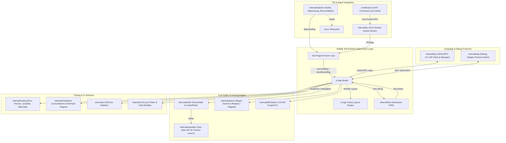
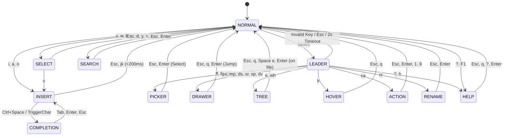
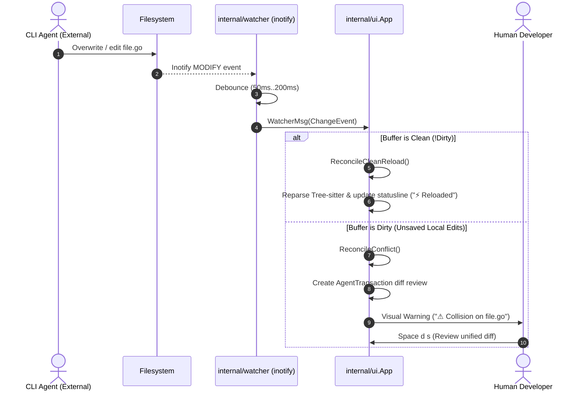
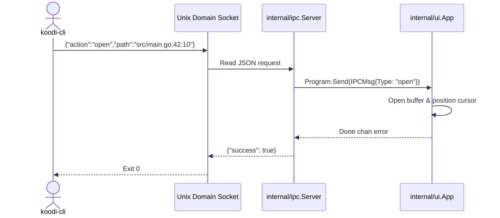

# Koodieditori System Architecture & Technical Contract


**Document:** `docs/ARCHITECTURE.md`  
**Status:** Canonical Architectural & UI Contract  
**Target:** Core Maintainers, System Engineers, and Autonomous AI Coding Agents  

---

## 1. Executive Summary & Design Principles

**Koodieditori** is a high-performance, keyboard-driven Terminal User Interface (TUI) code editor engineered specifically for Linux tiling window managers (Wayland / Niri) and built for concurrent pairing with **autonomous CLI coding agents** (e.g. Antigravity CLI, Claude Code, Aider).

### Core Architectural Axioms

1. **Zero Web Technology Overhead:**
   - Absolutely zero Electron, Tauri, Node.js, WebAssembly, HTML, CSS, or browser runtimes.
   - 100% pure **Go (1.22+)** with standard CGo restricted exclusively to native Tree-sitter C grammar libraries.
2. **Sub-20ms Startup & Minimal Footprint:**
   - Initial boot to interactive prompt takes `<20ms` with memory consumption under `30MB`.
   - Avoids synchronous I/O on startup. Background operations (inotify setup, LSP/DAP initialization, git status, tree indexing) dispatch as asynchronous Bubble Tea commands (`tea.Cmd`).
3. **Nordic & ISO Keyboard Ergonomics:**
   - Core bindings and text object selectors never require `AltGr` combinations (`[`, `]`, `{`, `}`, `\`, `|`) or dead keys (`` ` ``, `~`, `^`).
   - Mnemonic alphanumeric letters (`m i b` for block, `m i a` for array, `m i p` for parens, `m i q` for quote, `m i f` for function, `m i c` for class/struct) guarantee equal ergonomics on Scandinavian and US laptop keyboards.
4. **Zero Screen-Space Waste (Ephemeral Panes):**
   - No permanent, tiled output splits that crowd 13–15" laptop screens.
   - All tool outputs, diagnostics, debug inspectors, search/replace prompts, markdown previews, and diff reviews live in **Ephemeral Drawers** or **Overlay Modals** that dismiss with a single key (`Esc` or `q`).
5. **Autonomous Agent Coexistence via Unix Socket IPC:**
   - External CLI agents communicate directly with running editor sessions via a Unix domain socket protocol (`koodi-cli`).
   - File system changes made on disk are intercepted via `inotify`, debounced, and reconciled without race conditions or data loss.

---

## 2. High-Level Architectural Model

Koodieditori follows the **Elm Architecture** (`Init`, `Update`, `View`) implemented through the Bubble Tea runtime, decoupled into strict modular packages:



---

## 3. Subsystem Breakdown

### 3.1. Core Buffer Engine (`internal/buffer/`)

The text engine is built on a high-speed **Piece Table** data structure designed for constant-time edits and robust multi-step transaction history.

```text
Original Buffer: [ "package main\n\nfunc main() {}\n" ] (Read-only on mmap/load)
Add Buffer:      [ "    fmt.Println(\"Hello\")\n" ]    (Append-only)

Piece Chain:
  Piece 0: Original[0..29] ("package main\n\nfunc main() {")
  Piece 1: Add[0..27]      ("\n    fmt.Println(\"Hello\")\n")
  Piece 2: Original[29..31] ("}\n")
```

#### Key Guarantees:
- **Zero Raw String Manipulation in UI Models:** All mutations route strictly through `PieceTable.Insert(offset, text)` and `PieceTable.Delete(offset, length)`.
- **Transactions (`BeginTransaction()` / `CommitTransaction()`):** Group batch operations (e.g. typing a continuous word, code formatting, multi-line indentation, search-and-replace all, or agent diff applications) into an atomic undo/redo node.
- **Atomic File Writes:** Saving a buffer writes to a temporary file in the target directory, invokes `fsync()`, and executes an atomic `os.Rename()` to prevent corruption on crash or power loss.
- **Rune & UTF-8 Safety:** 1 byte $\neq$ 1 character. All column offsets and character widths account for multi-byte UTF-8 sequences (`ä`, `ö`, `å`, emojis) using `utf8.RuneCount` and line-index offset calculation (`lineindex.go`).
- **Thread Safety:** Protected via `sync.RWMutex` for concurrent access by the main UI loop, LSP/DAP clients, inotify watcher, and IPC goroutines.

---

### 3.2. Finite State Machine (`internal/fsm/`)

User input is deterministically dispatched by a centralized Finite State Machine (`internal/fsm/fsm.go`):



#### Complete State Table:
| State Enum | Visual Badge | Active Surface | Primary Input Target |
| :--- | :--- | :--- | :--- |
| `StateNormal` | ` NORMAL ` | Code Viewport | Cursor movement, single-character delete/yank, leader/match triggers |
| `StateInsert` | ` INSERT ` | Code Viewport | Direct text entry into Piece Table, auto-pairs, completion triggers |
| `StateSelect` | ` SELECT ` | Code Viewport | Text object operations (`d`, `c`, `y`, `>`, `<`, `!`) |
| `StateLeader` | ` LEADER ` | Statusline | Mnemonic chord completion (2000ms timeout) |
| `StateMatchPending` | ` MATCH ` | Statusline | Awaiting AST target letter (`m i ...` / `m a ...`) |
| `StateTree` | ` TREE ` | File Tree Sidebar | Tree navigation, directory toggle, new file/folder (`a`/`A`), delete (`d d`) |
| `StateDrawer` | ` DRAWER ` | Ephemeral Drawer | Error stepping, test log review, search & replace, markdown preview, diff review |
| `StatePicker` | ` PICKER ` | Centered Modal | Fuzzy file/buffer/live-grep query entry and candidate selection |
| `StateHover` | ` HOVER ` | Floating Tooltip | Viewing and scrolling LSP documentation hover popovers (`K` / `Space k`) |
| `StateCompletion` | ` COMPL ` | Floating Popover | Navigating and accepting LSP autocomplete suggestions (`Tab`, `Enter`, `Up`/`Down`) |
| `StateCodeAction` | ` ACTION ` | Floating Menu | Selecting LSP code actions (`1..9`, `j`/`k`, `Enter`) |
| `StateRename` | ` RENAME ` | Statusline Prompt | Entering new identifier name for workspace-wide LSP rename (`Space c r`) |
| `StateSearch` | ` SEARCH ` | Statusline Prompt | Interactive incremental in-buffer search (`/ query█`) |
| `StateHelp` | ` HELP ` | Centered Modal | Interactive filterable keybindings cheatsheet & command palette (`?`, `F1`) |

#### Editable Prompt Sub-States & User Remaps:
- **`drawerEditable` / `treeEditable`:** When an interactive text prompt is active inside `StateDrawer` (e.g. Search & Replace fields) or `StateTree` (`a` for New File, `A` for New Folder), printable characters (`q`, `j`, `k`, `a`, `d`, `Space`) are routed as `ActionInsertText` rather than navigation shortcuts until `Enter` or `Esc` is pressed.
- **Dynamic User Key Remaps (`[keys.<mode>]`):** User-defined key bindings in `config.toml` / `koodi.toml` are parsed via `fsm.ParseActionType` and evaluated first before falling back to the built-in modal handlers.

---

### 3.3. Deterministic UI Layout & Coordinate System (`internal/ui/`)

Given terminal dimensions $(W, H)$ where $x \in [0, W-1]$ and $y \in [0, H-1]$, the screen is partitioned into explicit non-overlapping regions:

```text
+-------------------------------------------------------------------------------+ Row 0: Bufferline Tabs
| ‹ [1: main.go*]  [2: server.cpp [A]]  [3: README.md]                        › |
+-------------------+-----------------------------------------------------------+ Row 1: Main Work Area
| FileTree Sidebar  │ Editor Gutter + Code Viewport + Scrollbar (│/█)           |
| (Width: W_tree)   │ (Width: W - W_tree)                                       |
|                   │                                                           |
|                   ├───────────────────────────────────────────────────────────┤ Row H - H_drawer - 1
|                   │ Ephemeral Output / Markdown / Search / Debug / Diff Drawer|
|                   │ (Height: H_drawer)                                        |
+-------------------+-----------------------------------------------------------+ Row H - 2: Bottom of Main Body
| NORMAL | src/main.go* | Go | E:0 W:1 | [gopls: ok] | Ln 42, Col 8 (65%)       | Row H - 1: Statusline
+-------------------------------------------------------------------------------+
```

#### Component Coordinate Boundaries:
| Component | X Range (Columns) | Y Range (Rows) | Visibility Condition |
| :--- | :--- | :--- | :--- |
| **`Bufferline`** | $[0, W-1]$ | $y = 0$ | Always visible (single line, active-tab windowing with `‹`/`›` overflow indicators) |
| **`FileTree`** | $[0, W_{\text{tree}}-1]$ | $[1, H-2]$ | Visible when `FileTree.Open == true` |
| **`Gutter`** | $[X_{\text{edit}}, X_{\text{edit}} + W_{\text{gutter}} - 1]$ | $[1, Y_{\text{edit\_end}}]$ | Always visible ($W_{\text{gutter}} = \max(6, \text{digits}(\text{LineCount}) + 3)$) |
| **`Viewport`** | $[X_{\text{edit}} + W_{\text{gutter}}, W-1]$ | $[1, Y_{\text{edit\_end}}]$ | Always visible (rightmost column renders `│`/`█` scrollbar when `LineCount > Height`) |
| **`OutputDrawer`** | $[X_{\text{edit}}, W-1]$ | $[H - 1 - H_{\text{drawer}}, H-2]$ | Visible when `Drawer.Open == true` |
| **`Statusline`** | $[0, W-1]$ | $y = H-1$ | Always visible (strictly single-line via `ansi.Truncate`) |
| **`FuzzyPicker` / `HelpModal`** | Centered $\approx 66\% W$ | Centered $\approx 66\% H$ | Visible when `State == StatePicker` or `State == StateHelp` |

#### Terminal Column Width & Scroll Invariants:
1. **Strict Visual Width Truncation:** Every row rendered by `FileTree`, `Viewport`, `OutputDrawer`, `Bufferline`, and `Statusline` is measured with `lipgloss.Width` / `runewidth.RuneWidth` and truncated or padded to its exact pixel/column budget so multi-byte box-drawing glyphs (`─`, `│`), wide emojis (`⚡`, `⚠`), and Glamour ANSI escape codes never wrap across terminal lines and desynchronize horizontal joins.
2. **Gutter Columns:**
   - `Col 0`: Git diff sign (`+` Added, `~` Modified, `_` Deleted).
   - `Col 1`: Breakpoint / execution / diagnostic sign (`▶` DAP stopped line, `●` DAP breakpoint, `E` Error, `W` Warning, `I` Info, `A` Agent-modified).
   - `Cols 2..N-2`: Line number (relative or absolute).
   - `Col N-1`: Space separator.
3. **SGR Mouse Event Routing:**
   - Supports left click positioning, gutter `Col 1` click to toggle breakpoints, drag selection, double-click word selection, triple-click line selection, scrollbar track click-to-jump and thumb drag-scrubbing, two-finger wheel scrolling, tab bar click/middle-click close, and border drag-to-resize (`FileTree` vertical border and `OutputDrawer` horizontal border).

---

### 3.4. Tree-sitter AST & Chroma Polyglot Highlighting (`internal/treesitter/`)

Koodieditori combines native CGo **Tree-sitter** AST parsers (Go, C/C++, Java, Markdown, Bash, JSON, YAML, TOML) with **Chroma** high-speed lexers (XML, Makefile, CMake, Zsh, Dockerfile, INI):

1. **VS Code-Aligned Semantic Token Categories:**
   - Distinct styles for `Keyword` (control flow), `Declaration` (`func`, `type`, `class`, `struct`), `Function` (definitions & calls), `Type`, `String`, `Comment`, `Number`, `Operator`, `Constant`, and `Variable`.
   - Zero-config `"terminal"` theme inherits the user's native terminal background and ANSI 16 palette while allowing granular overrides in `[theme.colors]` and `[theme.syntax]`.
2. **AST-Driven & Structural Semantic Text Objects (`m i <obj>` / `m a <obj>`):**
   - **`f`:** Function declaration, method body, or Makefile rule recipe.
   - **`c`:** Class, struct, interface, or TOML `[table]` section.
   - **`b`:** Code block `{ ... }`, Shell `if/then/fi` or `do/done` block, XML `<tag>...</tag>`, or YAML indented mapping.
   - **`a`:** Array, slice `[ ... ]`, or YAML sequence.
   - **`p`:** Parentheses `( ... )`, CMake command arguments, subshell `$(...)`, or Makefile `$(VAR)`.
   - **`q`:** String literal (`"..."`, `'...'`, `` `...` ``).

---

### 3.5. Native LSP Client & Manager (`internal/lsp/`)

A zero-dependency, pure Go **JSON-RPC 2.0 Language Server Protocol** implementation communicating asynchronously over stdio (`Content-Length` framing):

- **Multi-Language Server Manager:** Manages workspace-scoped language server processes (`gopls`, `clangd`, `jdtls`, `bash-language-server`, `vscode-json-language-server`, `yaml-language-server`, `taplo`, `lemminx`, `cmake-language-server`).
- **Strict UTF-16 Position Encoding (`utf16.go`):** Converts accurately between Go UTF-8 rune column indices and LSP UTF-16 code units (`RuneColToUTF16Col` and `UTF16ColToRuneCol`), properly handling surrogate pairs (emojis) and Nordic characters (`ä`, `ö`, `å`).
- **Dual Request ID Support:** Handles both integer and string/UUID JSON-RPC request/response IDs for compatibility with all language servers.
- **Capabilities:**
  - Real-time `textDocument/publishDiagnostics` pushed via `DiagnosticsMsg`.
  - `textDocument/definition`, `textDocument/implementation`, and `textDocument/prepareCallHierarchy`.
  - `textDocument/hover` floating Markdown tooltips.
  - `textDocument/completion` with prefix replacement and `TextEdit` application.
  - `textDocument/codeAction` floating quickfix menu and `textDocument/rename` atomic multi-buffer workspace edits.

---

### 3.6. Native Debug Adapter Protocol Client (`internal/dap/`)

A pure Go **Debug Adapter Protocol (DAP)** client supporting interactive source-level debugging for Go (`dlv dap`), C/C++ (`lldb-dap` / `gdb -i=dap`), and Java (`java-debug`):

- **Breakpoint Management:** Stores per-file line breakpoints synced with the active adapter via `setBreakpoints`.
- **Execution Control:** Full lifecycle commands (`Launch`, `ConfigurationDone`, `Continue`, `Next`, `StepIn`, `StepOut`, `Pause`, `Disconnect`) bound to both Nordic `Space d ...` chords and `F5`/`F9`–`F11` function keys.
- **Live Inspector (`Space d v`):** Asynchronous retrieval of `StackTrace`, `Scopes`, and `Variables` upon `stopped` events, rendered inside the ephemeral Debug Inspector Drawer.

---

### 3.7. In-Buffer & Project Search & Replace Engine (`internal/search/`)

- **Incremental Search (`/`):** Compiles literal or regex queries with smart-case detection, computing line/column match ranges (`Match`) and highlighting all visible occurrences in real time.
- **Regex Capture Group Replacement (`Space s r` / `Space s p`):** Supports `$1`, `$2` and `\1`, `\2` capture group expansion with live before/after diff previews in the drawer.
- **Single-Undo Batch Replace:** In-buffer and project-wide replacements execute inside a single `PieceTable` transaction so pressing `u` undoes the entire batch operation cleanly.
- **Live Grep (`Space f g`):** Spawns `ripgrep` (`rg --vimgrep`) asynchronously once query length $\ge 2$ characters to prevent UI stutter.

---

### 3.8. Inotify Watcher & Collision Reconciliation (`internal/watcher/`)

To support autonomous CLI agent pairing, the editor continuously monitors the workspace using Linux `inotify`:



#### Filtering Rules:
- Automatically ignores heavy build and dependency directories: `target/`, `node_modules/`, `.git/`, `build/`, `.gradle/`, `.ccls-cache`, `.cache/`.
- All change events are debounced (minimum `50ms`) to prevent event floods during bulk compiler writes or git checkouts.

---

### 3.9. Myers Diff & Agent Transaction Engine (`internal/diff/`)

Autonomous coding agents often modify multiple files in rapid succession. Rather than treating these as disconnected events, Koodieditori aggregates them into **Agent Transactions**:

- **Myers / LCS Diff Algorithm:** Pure Go implementation of the Eugene Myers longest common subsequence (LCS) algorithm producing unified diffs and per-line gutter signs (`+`, `~`, `_`).
- **Transaction Ledger (`AgentTransaction`):** Records before/after text snapshots and diff statistics (`+lines`, `-lines`).
- **Interactive Review Drawer (`Space d s`):**
  - Displays multi-file changes with status tags (`[M]`, `[A]`, `[D]`).
  - Allows stepping through files using Nordic quick-step keys (`ä` next, `ö` prev).
  - Batch operations: **`Space d a`** (Accept All) or **`Space d r`** (Revert All).

---

### 3.10. Unix Domain Socket IPC (`internal/ipc/` & `cmd/koodi-cli`)

Instead of embedding heavy scripting engines (Lua/Python/JS), Koodieditori exposes its full API over a Unix Domain Socket:

- **Socket Location:** `$XDG_RUNTIME_DIR/koodi/koodi-<session>.sock` (fallback: `/tmp/koodi-<uid>/koodi-<session>.sock`).
- **Protocol:** Framing using newline-delimited JSON RPC.



#### Supported IPC Endpoints:
1. `open`: Open a file and position cursor at `line:col`.
2. `diff`: Display an interactive unified diff for a path.
3. `reload`: Force buffer reloading from disk (`--all` or target file).
4. `notify`: Push a transient notification to the statusline (`info`, `warn`, `error`).
5. `status-badge`: Display agent activity badge and pulsing busy state on the statusline.
6. `action`: Trigger any FSM action programmatically (`drawer:toggle`, `filetree:toggle`, `agent:review`, etc.).

---

### 3.11. Terminal Markdown & Mermaid Engine (`internal/markdown/`)

Rich Markdown editing and preview without web engines:

- **In-Buffer Visual Concealment:** Dynamic line-level concealment hiding raw markdown markers (`**`, `*`, `[]()`) on inactive lines while exposing full raw syntax under the cursor.
- **Interactive Checklists:** Instant toggling of `- [ ]` $\leftrightarrow$ `- [x]` on `Space m t` or mouse click.
- **Glamour Preview Drawer:** Slides up an ephemeral drawer rendering Markdown via Glamour ANSI formatting with sanitized single-line output lines.
- **Mermaid Box-Art & Kitty Protocol Engine:**
  - Standard mode: Universal Unicode box-art (`┌─┐`, `│`, `▼`, `▶`) rendering flowcharts and sequence diagrams.
  - Wayland mode: Native Kitty Graphics Protocol cell rasterization for high-resolution graphics on supported terminals (Foot, Kitty, WezTerm).

---

## 4. Concurrency Model & Thread Safety

Koodieditori handles concurrent operations across multiple independent goroutines:

```text
[Main Goroutine (Bubble Tea)] ──> Handles UI loop, rendering, keyboard & mouse input
                                      ▲
                                      │ Channels (tea.Msg / IPCMsg / WatcherMsg / DiagnosticsMsg / EventMsg)
                                      ▼
[LSP Client Goroutines]       ──> Async stdio JSON-RPC read/write loops & diagnostics dispatch
[DAP Client Goroutines]       ──> Async debug adapter event & response reader loops
[Inotify Watcher Goroutine]   ──> Detects disk changes, debounces, posts WatcherMsg
[IPC Socket Listener]         ──> Accepts socket connections, spawns client handlers
[IPC Client Worker]           ──> Decodes JSON RPC, sends IPCMsg to Program, awaits response
[Tree-sitter Parser]          ──> Incremental AST re-parsing of edited buffers
```

### Safety Rules:
1. **Zero Data Races:** All commits must pass `go test -race ./...` with zero data races.
2. **Buffer Access Serialization:** State modifications to `App`, `PieceTable`, and `BufferItem` structures route through the Bubble Tea main message loop or are protected by `sync.RWMutex`.
3. **Non-Blocking Channel Operations:** Background handlers use select blocks with timeouts to prevent hanging the editor if a channel is full.

---

## 5. File System & Configuration Layout

```text
~/.config/koodi/
  └── config.toml                  # Global user configuration

<workspace_root>/
  ├── koodi.toml                   # Project root configuration override (optional)
  ├── .koodi/
  │    └── config.toml             # Project .koodi directory override (optional)
  └── ...                          # Project source files

$XDG_RUNTIME_DIR/koodi/ (or /tmp/koodi-<uid>/)
  └── koodi-default.sock           # Unix Domain Socket for IPC
```

### Configuration Precedence (Highest to Lowest):
1. Local workspace config (`koodi.toml` or `.koodi/config.toml`)
2. User global config (`~/.config/koodi/config.toml`)
3. Hardcoded internal defaults ([`internal/config/config.go`](../internal/config/config.go))

---

## 6. Directory Map & Package Responsibilities

| Package Path | Responsibility | Prohibitions / Constraints |
| :--- | :--- | :--- |
| `cmd/koodi/` | Main editor application entrypoint | No business logic; initializes models and starts Bubble Tea program |
| `cmd/koodi-cli/` | External companion CLI tool | Must only communicate via Unix domain socket IPC |
| `internal/buffer/` | Piece Table, undo/redo stacks, line indexing, atomic file writes | No UI logic; thread-safe mutations |
| `internal/config/` | TOML configuration loader, theme defaults, and key remap parser | Zero dependencies on UI models |
| `internal/fsm/` | Finite State Machine, mode transitions, action & remap dispatch | Deterministic; no direct view rendering |
| `internal/ui/` | Bubble Tea models, layout, viewport, gutter, tabs, statusline, tree, picker, help | Must return deterministic string layouts using Lip Gloss |
| `internal/treesitter/` | Tree-sitter AST parsers, Chroma lexers, semantic text objects | Uses standard CGo; must handle grammar loading gracefully |
| `internal/lsp/` | JSON-RPC 2.0 LSP client, server lifecycle, UTF-16 position conversion | Zero external dependencies; strict UTF-16 coordinate math |
| `internal/dap/` | Debug Adapter Protocol client, breakpoints, stack & variable inspection | Pure Go JSON-RPC over stdio/TCP |
| `internal/search/` | In-buffer & project search/replace engine, regex capture groups, ripgrep | Live grep requires $\ge 2$ query chars; batch replace uses single transaction |
| `internal/tooling/` | Compiler/linter error parsers, jumplist history, C++ alternate toggle | Pure Go; regex parsers for GCC, Clang, Javac, Maven, Go, ShellCheck, CMake |
| `internal/markdown/` | Concealment, Glamour preview, Mermaid box-art/Kitty graphics | Zero web technology runtimes |
| `internal/watcher/` | Linux inotify file watcher and debounce reconciler | Must filter heavy build folders; debounced $\ge 50\text{ms}$ |
| `internal/diff/` | Myers diff algorithm, agent transactions, review ledger | Pure Go; no external `git diff` dependency for core diffing |
| `internal/ipc/` | Unix domain socket server and RPC protocol handlers | Safe concurrency; non-blocking request dispatch |
| `test/` | End-to-end integration tests, Nordic keybinding verification, benchmarks | Must pass `go test -race ./...` |
| `docs/` | Canonical architecture specification (`ARCHITECTURE.md`) and user manual (`USER_MANUAL.md`) | Keep documentation in sync with codebase modifications |
