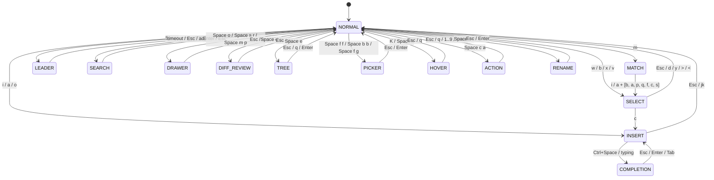

# Koodieditori: User Manual & Operational Reference


**Document:** `docs/USER_MANUAL.md`  
**Applicable Version:** Koodieditori v1.0.0  
**Binary Targets:** `bin/koodi` (Interactive TUI), `bin/koodi-cli` (Agent & Shell IPC Companion)  

---

## 1. Introduction & Core Philosophy

**Koodieditori** is an ultra-fast, zero-dependency, pure Go (1.22+) terminal code editor engineered for demanding software development environments, keyboard-centric power users, and autonomous AI coding agents.

It includes first-class out-of-the-box support for **Go, C, C++, Java, Markdown, JSON, TOML, YAML, XML, Bash, Zsh, Makefile, and CMake** powered by native Tree-sitter AST parsing and pure-Go Chroma high-speed lexers.

### Core Architectural Principles

1. **Selection-First Editing (`Object -> Action`):**
   Traditional modal editors like Vim follow a `Verb -> Object` paradigm (e.g. `d w` to delete a word, where you cannot see what will be deleted until after it is gone). Koodieditori follows a **Selection-First** paradigm (inspired by Kakoune and Helix): select or target text first so it is immediately highlighted on screen, then apply the action (`d` delete, `c` change, `y` yank, `>` indent).
2. **Ergonomic Nordic / Scandinavian Keyboard Layouts:**
   Standard US-centric editor keybindings rely heavily on braces `{`, `}`, brackets `[`, `]`, pipes `|`, backslashes `\`, and backticks `` ` ``, which require awkward `AltGr` combinations or dead keys on Nordic ISO laptop keyboards. Koodieditori eliminates all `AltGr` and dead key dependencies for core bindings, replacing them with mnemonic letter text objects (`m i b` for block `{}`) and space leader chords.
3. **Ephemeral Drawers (Zero Screen Clutter):**
   Koodieditori strictly prohibits persistent terminal split panes that permanently waste screen real estate. All task, preview, search, diagnostic, debug inspector, and review interfaces slide up as ephemeral bottom drawers that dismiss instantly with `Esc` or `q`, or maximize with `Z`.
4. **Sub-20ms Cold Startup:**
   Synchronous disk I/O, heavy file scanning, and background language servers are completely decoupled from initial editor startup. The editor starts and renders its first visual frame in **~4.0ms**.
5. **Ripgrep (`rg`) First-Class Integration:**
   Ripgrep is detected automatically (`/usr/bin/rg`) and leveraged for high-throughput workspace file discovery, live grep, and project search-and-replace, seamlessly respecting `.gitignore` rules with automatic fallback to pure Go walking when needed.
6. **Agentic Coexistence via Unix Domain Socket IPC:**
   No embedded scripting engine bloat. External tools, scripts, and AI coding agents communicate with the running editor via an asynchronous Unix Domain Socket API (`koodi-cli`), featuring transactional diff reviews and live inotify reconciliation.

---

## 2. Installation & Quick Start

### Building from Source

Ensure **Go 1.22+** and a C compiler (GCC or Clang for Tree-sitter CGo grammars) are installed.

```bash
# Clone the repository
git clone git@github.com:mikolas/koodieditori.git
cd koodieditori

# Build production binaries
make build

# Binaries generated:
# bin/koodi       - Main terminal editor
# bin/koodi-cli   - External IPC CLI companion
```

### Launching the Editor

```bash
# Open editor in current workspace
./bin/koodi

# Open a specific project directory (roots workspace, file tree explorer, picker, and LSP)
./bin/koodi /path/to/project
./bin/koodi .

# Open editor with specific files loaded into tabs (auto-detects project root)
./bin/koodi main.go internal/buffer/piecetable.go docs/USER_MANUAL.md
```

### Ripgrep Requirement & Setup

Koodieditori leverages **ripgrep (`rg`)** for workspace-wide text search (`Space f g` Live Grep) and project search-and-replace (`Space s p`). If ripgrep is installed on your system, Koodieditori uses it automatically:

```bash
# Debian / Ubuntu / Pop!_OS
sudo apt-get install ripgrep

# Fedora / RHEL
sudo dnf install ripgrep

# Arch Linux / Manjaro
sudo pacman -S ripgrep
```

If ripgrep is not available in the environment, Koodieditori automatically falls back to its built-in pure Go recursive project scanner without any configuration required.

---

## 3. Editor Interface Anatomy

```text
┌────────────────────────────────────────────────────────────────────────┐
│ [1: main.go*]  [2: engine.cpp]  [3: README.md]                         │ ← 1. Bufferline Tabs
├────────────────────────────────────────────────────────────────────────┤
│   1   package main                                                   █ │ ← 2. Code Viewport
│   2                                                                  │ │   (Gutter + Text +
│   3   func main() {                                                  │ │    Vertical Scrollbar)
│   4 ▶     fmt.Println("Hello, Koodi!")                               │ │
│   5   }                                                              │ │
├────────────────────────────────────────────────────────────────────────┤
│ ──── Search & Replace (Esc to close, Enter to Replace All) ─────────── │ ← 3. Ephemeral Drawer
│   Find:    fmt.Println█                                                │   (Slides up on demand)
│   Replace: log.Printf                                                  │
│   Flags:   [Alt+c] Case: OFF  [Alt+w] Word: OFF  [Alt+r] Regex: OFF    │
│   Matches: 1 match(es)                                                 │
│   Preview Diff:                                                        │
│   - Line 4:     fmt.Println("Hello, Koodi!")                           │
│   + Line 4:     log.Printf("Hello, Koodi!")                            │
├────────────────────────────────────────────────────────────────────────┤
│ SEARCH  main.go*  Go  Ln 4, Col 5  12 lines  [1 match]  [gopls: ok]    │ ← 4. Statusline
└────────────────────────────────────────────────────────────────────────┘
```

1. **Top Bufferline Tabs:** Displays all open buffers with buffer IDs (`1..9`), dirty modification indicator `*`, read-only lock `[RO]`, and active LSP diagnostic count `!%d`. Direct switch with `Alt+1` .. `Alt+9` or cycle with `H` / `L`.
2. **Code Viewport, Gutter & Scrollbar:**
   - **Columns 1–4:** Line numbers (supports absolute and relative line numbers).
   - **Column 5:** Diagnostic signs: `E` (Bright Red Error), `W` (Yellow Warning), `I` (Blue Info).
   - **Column 6:** Git diff hunk signs: `+` (Green Added), `~` (Cyan Modified), `-` (Red Deleted).
   - **Text Area:** Syntax-highlighted code with multi-byte UTF-8 rune column alignment, visual selections, and search match tokens.
   - **Rightmost Column (Scrollbar):** Automatic vertical scrollbar displayed whenever buffer line count exceeds viewport height. Solid thumb block `█` shows current scroll position and proportional thumb size, while track rail `│` marks travel boundaries. Supports interactive mouse click-to-jump and click-and-drag scrubbing.
3. **Ephemeral Bottom Drawer:** Slides up dynamically when requested (`Space o` Output, `Space s r` Search/Replace, `Space m p` Markdown preview, `Space d s` Agent diff review). Resize with `Space w +` / `Space w -`, maximize with `Z`, close with `Esc` or `q`.
4. **Statusline:** Displays active modal interaction state, current file path, language file type, cursor line and column coordinates, total line count, live search match status, agent transaction status, and LSP server status.

---

## 4. Modal Interaction States (FSM)

Koodieditori operates as a deterministic Finite State Machine (FSM) spanning 14 interaction states:



---

## 5. Exhaustive Keyboard Command Reference

### 5.1 Basic Navigation & Cursor Movement (`NORMAL` Mode)

| Key | Action | Description |
| :--- | :--- | :--- |
| `h` / `Left` | Move Left | Move cursor 1 character left |
| `l` / `Right` | Move Right | Move cursor 1 character right |
| `j` / `Down` | Move Down | Move cursor 1 line down |
| `k` / `Up` | Move Up | Move cursor 1 line up |
| `0` / `^` / `Home` | Line Start | Move cursor to column 0 of current line |
| `$` / `End` | Line End | Move cursor to end of current line |
| `Ctrl+Right` / `Alt+Right` | Word Forward | Jump cursor to start of next word |
| `Ctrl+Left` / `Alt+Left` | Word Backward | Jump cursor to start of previous word |
| `Ctrl+Home` | Buffer Start | Jump cursor to line 0, column 0 |
| `Ctrl+End` / `G` | Buffer End | Jump cursor to the last line of buffer |
| `Ctrl+u` / `Ctrl+b` / `PgUp` | Page Up | Scroll viewport and cursor up half a page |
| `Ctrl+d` / `Ctrl+f` / `PgDn` | Page Down | Scroll viewport and cursor down half a page |
| `ö` | Quick Step Back | Jump to previous error or diagnostic (Nordic fast key) |
| `ä` | Quick Step Forward | Jump to next error or diagnostic (Nordic fast key) |
| `Ctrl+o` | Jumplist Back | Jump backward in cross-file location history |
| `Ctrl+i` | Jumplist Forward | Jump forward in cross-file location history |
| `Ctrl+w` | Cycle Active Pane | Cycle focus between File Tree $\to$ Viewport $\to$ Drawer |

#### Navigation Usage Examples

##### 1. Character & Line Navigation (`h`, `j`, `k`, `l`, `0`, `$`)
```text
Given cursor at column 10:
  Press 'h'       -> Move cursor 1 column left
  Press 'l'       -> Move cursor 1 column right
  Press 'k'       -> Move cursor 1 line up
  Press 'j'       -> Move cursor 1 line down
  Press '0'       -> Jump immediately to column 0 (start of line)
  Press '$'       -> Jump immediately to the final rune of the line
```

##### 2. Word & Buffer Boundary Navigation (`Ctrl+Right`, `Ctrl+Left`, `Ctrl+Home`, `Ctrl+End`)
```text
Code:
  fmt.Println("Processing user request:", userID)
  ^ (cursor here)

- Press 'Ctrl+Right' (or 'Alt+Right') -> Cursor jumps to 'Println'
- Press 'Ctrl+Right' again           -> Cursor jumps to '"Processing'
- Press 'Ctrl+Left' (or 'Alt+Left')  -> Cursor jumps backward to 'Println'
- Press 'Ctrl+Home'                  -> Cursor jumps to Line 1, Column 0 of the entire file
- Press 'Ctrl+End' (or 'G')          -> Cursor jumps to the very last line of the buffer
```

##### 3. Paging & Viewport Scrolling (`Ctrl+u`, `Ctrl+d`, `PgUp`, `PgDn`)
```text
- Press 'Ctrl+d' (or 'PgDn') -> Viewport and cursor scroll down by half a screen (smooth paging)
- Press 'Ctrl+u' (or 'PgUp') -> Viewport and cursor scroll up by half a screen
```

##### 4. Nordic Quick Diagnostic Stepping (`ä`, `ö`)
```text
When working with compiler errors or LSP diagnostics:
- Press 'ä' -> Jumps directly to the next compilation error or warning in the project
- Press 'ö' -> Jumps back to the previous compilation error or warning
Statusline automatically displays the corresponding diagnostic message.
```

##### 5. Jumplist Cross-File Navigation (`Ctrl+o`, `Ctrl+i`)
```text
Workflow:
1. You are at 'main.go:42' and press 'Space g d' to jump to a function definition in 'engine/worker.go:120'.
2. After inspecting the code, press 'Ctrl+o' -> Instantly returns to 'main.go:42'.
3. Press 'Ctrl+i' -> Steps forward again to 'engine/worker.go:120'.
```

##### 6. Pane Focus Cycling (`Ctrl+w`)
```text
With File Tree sidebar open and an Output Drawer open:
- Press 'Ctrl+w' -> Shifts focus: Code Viewport -> Ephemeral Drawer -> File Tree -> Code Viewport.
```

---

### 5.2 Mode Switching & Basic Mutations (`NORMAL` Mode)

| Key | Target Mode | Description |
| :--- | :--- | :--- |
| `i` | `INSERT` | Enter insert mode before current cursor position |
| `a` | `INSERT` | Move cursor 1 column right and enter insert mode |
| `o` | `INSERT` | Open a new line below cursor and enter insert mode |
| `w` | `SELECT` | Select word under cursor forward |
| `b` | `SELECT` | Select word under cursor backward |
| `x` | `SELECT` | Select the entire current line |
| `v` | `SELECT` | Start characterwise visual selection from cursor anchor |
| `m` | `MATCH` | Await inside (`i`) or around (`a`) text object letter |
| `?` / `F1` | `HELP` | Open interactive Help & Keybindings cheatsheet modal |
| `/` | `SEARCH` | Open interactive search prompt in statusline |
| `n` | `NORMAL` | Step forward to next search match |
| `N` | `NORMAL` | Step backward to previous search match |
| `d` | `NORMAL` | Delete character under cursor |
| `y` | `NORMAL` | Yank character under cursor into yank register |
| `p` | `NORMAL` | Paste yank register after cursor |
| `P` | `NORMAL` | Paste yank register before cursor |
| `u` | `NORMAL` | Single-step atomic undo |
| `U` | `NORMAL` | Single-step atomic redo |
| `H` | `NORMAL` | Switch to previous buffer tab |
| `L` | `NORMAL` | Switch to next buffer tab |
| `Alt+1` .. `Alt+9` | `NORMAL` | Switch directly to buffer tab 1 through 9 |
| `K` | `HOVER` | Open LSP hover documentation popover for symbol under cursor |

#### Mutation & Mode Switching Usage Examples

##### 1. Entering Insert Mode (`i`, `a`, `o`)
```text
Code:
  count = 10
        ^ (cursor on '1')

- Press 'i' -> Enters INSERT mode before '1'. Type '2' -> Result: count = 210
- Press 'a' -> Enters INSERT mode after '1'. Type '5'  -> Result: count = 150
- Press 'o' -> Opens a brand new empty line below 'count = 10', indents properly, and enters INSERT mode.
```

##### 2. Quick Selections from Normal Mode (`w`, `b`, `x`, `v`)
```text
Code:
  status := checkDatabaseHealth()
                ^ (cursor on 'Database')

- Press 'w' -> Highlights 'DatabaseHealth' forward and enters SELECT mode
- Press 'b' -> Highlights 'check' backward and enters SELECT mode
- Press 'x' -> Highlights the entire line 'status := checkDatabaseHealth()' in SELECT mode
- Press 'v' -> Anchors cursor; pressing 'l' extends characterwise selection rune by rune
```

##### 3. Character Deletion, Yanking & Pasting (`d`, `y`, `p`, `P`)
```text
Code:
  val := 42;
           ^ (cursor on ';')

- Press 'd' -> Deletes ';' instantly and saves it to register -> Code becomes 'val := 42'
- Move cursor to 'val' and press 'y' -> Yanks character 'v' into register
- Press 'p' -> Pastes 'v' after cursor
- Press 'P' -> Pastes 'v' before cursor
```

##### 4. Atomic Undo & Redo (`u`, `U`)
```text
1. You typed 'fmt.Println("debug")' in insert mode and exited with 'jk'.
2. Press 'u' -> The entire statement is undone in one single step.
3. Press 'U' -> The statement is restored cleanly via the undo tree.
```

##### 5. Buffer Tab Switching (`H`, `L`, `Alt+1` .. `Alt+9`)
```text
Bufferline tabs: [1: main.go] [2: engine.go*] [3: config.toml]
Currently on Tab 1 ('main.go'):
- Press 'L'     -> Switches active tab to Tab 2 ('engine.go')
- Press 'H'     -> Switches active tab back to Tab 1 ('main.go')
- Press 'Alt+3' -> Instantly switches directly to Tab 3 ('config.toml')
```

##### 6. Hover Documentation (`K`)
```text
Move cursor over 'http.ListenAndServe' and press 'K':
- A floating popover opens immediately showing function signature, parameters, and doc comments:
  ┌────────────────────────────────────────────────────────┐
  │ func ListenAndServe(addr string, handler Handler) error│
  │ ListenAndServe listens on the TCP network address...   │
  └────────────────────────────────────────────────────────┘
- Press 'Esc' or 'q' to dismiss the popover.
```

##### 7. Atomic File Saving & Safe Buffer Closing (`Ctrl+S`, `Space f s`, `Space f a`, `Space b d`, `Space b D`)
```text
- Press 'Ctrl+S' or 'Space f s' -> Atomically saves the active buffer to disk using a temporary file + fsync + atomic rename, preserving file permissions and eliminating corruption risk.
- Press 'Space f a'             -> Atomically saves all open buffers that have unsaved modifications.
- Press 'Space b d'             -> Safely closes the active buffer tab. If the buffer has unsaved edits, Koodieditori warns you to protect your work.
- Press 'Space b D'             -> Force closes the active buffer tab, deliberately discarding unsaved changes.
- Press 'Ctrl+C'                -> If any buffer is dirty, requires pressing 'Ctrl+C' again within 2 seconds to confirm quitting with unsaved edits.
```

---

### 5.3 Insert Mode (`INSERT` Mode)

| Key | Action | Description |
| :--- | :--- | :--- |
| *Printable Runes* | Character Input | Inserts UTF-8 runes (supports Nordic `ä`, `ö`, `å`, emojis) |
| `Enter` | Newline | Inserts newline `\n`, advances cursor line, indent preserved |
| `Tab` | Tab / Spaces | Inserts configurable tab spaces (`tab_width` in `config.toml`) |
| `Backspace` | Backspace | Deletes character before cursor; joins lines if at column 0 |
| `Delete` | Delete | Deletes character at cursor position |
| `Ctrl+Space` | Autocomplete | Triggers LSP autocomplete suggestion popover |
| `j` followed by `k` | Fast Exit | Pressing `j` and `k` in rapid succession (<200ms) exits to `NORMAL` |
| `Esc` | Exit Insert | Exits insert mode and returns to `NORMAL` |

#### Insert Mode Usage Examples

##### 1. Multilingual Runes & Nordic Character Input
```text
Typing in INSERT mode fully respects UTF-8 multibyte runes:
- Type: 'käyttäjä := "Mäkinen" // 🚀'
  Cursor advances by exact visual column widths (runewidth-safe, emojis handled as 2 columns).
```

##### 2. Smart Indentation & Newlines (`Enter`, `Tab`)
```text
Given:
  func process() {
                  ^ (cursor at end of line)

- Press 'Enter' -> Cursor opens line below, automatically indenting 4 spaces (matching 'tab_width').
- Press 'Tab'   -> Inserts 4 spaces (or hard tab if 'expand_tab = false').
```

##### 3. Character Deletions (`Backspace`, `Delete`)
```text
Given:
  user.Name
          ^ (cursor after 'e')

- Press 'Backspace' -> Deletes 'e', cursor moves back 1 position.
- If cursor is at column 0 and you press 'Backspace', the line joins cleanly with the previous line.
- Press 'Delete'    -> Deletes the character directly under the cursor without moving cursor column.
```

##### 4. Triggering Autocomplete (`Ctrl+Space`)
```text
While typing 'fmt.Pr':
1. Press 'Ctrl+Space' -> Autocomplete popup opens:
   ┌────────────────────────────────┐
   │ Println   [fn]                 │
   │ Printf    [fn]                 │
   │ Print     [fn]                 │
   └────────────────────────────────┘
2. Use 'Down' / 'Up' (or 'Ctrl+n' / 'Ctrl+p') to select 'Printf'.
3. Press 'Tab' or 'Enter' -> Inserts 'Printf' and closes popup.
```

##### 5. Exiting Insert Mode (`jk` Fast Exit & `Esc`)
```text
While typing:
- Roll fingers 'j' then 'k' in rapid succession (<200ms) -> 'j' is erased, returns to NORMAL mode.
- Or simply press 'Esc' -> Immediately returns to NORMAL mode.
```

---

### 5.4 Selection-First Editing (`SELECT` Mode)

In Koodieditori, you select text first to see exact highlighted bounds, then execute the command:

| Key | Action | Resulting State | Description |
| :--- | :--- | :--- | :--- |
| `d` | Delete | `NORMAL` | Deletes selected text and saves it to yank register |
| `c` | Change | `INSERT` | Deletes selected text and immediately enters `INSERT` mode |
| `y` | Yank | `NORMAL` | Copies selected text to yank register and system clipboard |
| `>` | Indent | `SELECT` | Indents all lines intersecting the selection by `tab_width` |
| `<` | Outdent | `SELECT` | Outdents all lines intersecting the selection by `tab_width` |
| `!` | Shell Filter | `NORMAL` | Prompts to pipe selection through an external command |
| `h` / `j` / `k` / `l` | Extend Selection | `SELECT` | Expands visual selection boundary left, down, up, right |
| `w` | Extend Word | `SELECT` | Expands selection to end of next word |
| `b` | Extend Word Back | `SELECT` | Expands selection to beginning of previous word |
| `x` | Expand Line | `SELECT` | Expands selection to encompass entire line |
| `Esc` | Collapse | `NORMAL` | Collapses selection back to a single cursor |

#### Selection-First Usage Examples

##### 1. Delete Selection (`w` -> `d`)
```text
Original code:
  apiKey := "secret_old_token_xyz"
             ^ (cursor on 'secret')

1. Press 'w' -> Highlights 'secret_old_token_xyz' in green.
2. Press 'd' -> Deletes the token and returns to NORMAL mode:
  apiKey := ""
```

##### 2. Change Selection (`w` -> `c`)
```text
Original code:
  totalAmount := calculateSubtotal(items)
                 ^ (cursor on 'calculateSubtotal')

1. Press 'w' -> Highlights 'calculateSubtotal'.
2. Press 'c' -> Deletes word and enters INSERT mode.
3. Type 'computeTotal' and press 'jk' -> Result:
  totalAmount := computeTotal(items)
```

##### 3. Line Yank & Paste (`x` -> `y` -> `p`)
```text
Original code:
  log.Println("Starting server...")

1. Press 'x' -> Highlights the entire line.
2. Press 'y' -> Copies line to clipboard and yank register.
3. Press 'p' -> Pastes duplicated line below current position.
```

##### 4. Block Indentation & Outdent (`x` -> `j` -> `>` / `<`)
```text
Original code:
  stmtA()
  stmtB()
  stmtC()

1. Place cursor on 'stmtA()', press 'x' (selects line 1).
2. Press 'j' twice -> Selection expands across lines 1, 2, and 3.
3. Press '>' -> All three lines are shifted right by 4 spaces.
4. Press '<' -> All three lines are shifted left by 4 spaces.
```

##### 5. External Shell Filter (`!` -> shell command)
```text
Given unformatted JSON inside a file:
  {"b": 2, "a": 1}

1. Press 'x' to select the line.
2. Press '!' -> Statusline prompts: '! filter selection through command: '
3. Type 'jq .' and press 'Enter'.
4. Result in editor:
  {
    "a": 1,
    "b": 2
  }
```

##### 6. Expanding & Collapsing Selection Boundaries (`w`, `h/j/k/l`, `Esc`)
```text
1. Press 'w' on a word -> Word selected.
2. Press 'l' three times -> Selection expands 3 characters to the right.
3. Press 'w' again -> Selection expands to the end of the subsequent word.
4. Press 'Esc' -> Selection is cancelled and collapsed back to a single cursor.
```

---

### 5.5 Nordic Semantic Text Objects (`MATCH` Mode: `m i ...` / `m a ...`)

No `AltGr`, brackets, or dead keys required. Press **`m`** in `NORMAL` mode, followed by **`i`** (inside) or **`a`** (around), then the object letter:

| Key Chord | Targeted Semantic Region | Traditional Equivalent |
| :--- | :--- | :--- |
| **`m i b`** | Inside **Block** `{ ... }` | `i{` or `iB` |
| **`m a b`** | Around **Block** (including `{` and `}`) | `a{` or `aB` |
| **`m i a`** | Inside **Array / Bracket** `[ ... ]` | `i[` |
| **`m a a`** | Around **Array / Bracket** (including `[` and `]`) | `a[` |
| **`m i p`** | Inside **Parentheses** `( ... )` | `i(` or `ib` |
| **`m a p`** | Around **Parentheses** (including `(` and `)`) | `a(` or `ab` |
| **`m i q`** | Inside **Quote** `"..."` or `'...'` | `i"` |
| **`m a q`** | Around **Quote** (including quotes) | `a"` |
| **`m i f`** | Inside **Function** Body | Tree-sitter AST function body |
| **`m a f`** | Around **Function** (declaration + signature + body) | Tree-sitter AST function |
| **`m i c`** | Inside **Class / Struct** Body | Tree-sitter AST struct body |
| **`m a c`** | Around **Class / Struct** (declaration + body) | Tree-sitter AST struct |
| **`m i s`** | Around current **Statement** | Tree-sitter AST statement |

#### Semantic Text Object Usage Examples

##### 1. Block `{ ... }` (`m i b` / `m a b`)
```text
Code:
  if err != nil {
      log.Printf("failed: %v", err)
      return nil, err
  }

- Move cursor inside the if-block:
  Press 'm i b' -> Highlights the two lines between '{' and '}'.
  Press 'c'     -> Deletes content inside braces and enters INSERT mode.
  Press 'm a b' -> Highlights the braces '{ ... }' as well as their contents.
```

##### 2. Array / Bracket `[ ... ]` (`m i a` / `m a a`)
```text
Code:
  ports := []int{8080, 8443, 9090}
  items := ["apple", "banana", "cherry"]
            ^ (cursor on 'banana')

- Press 'm i a' -> Highlights '"apple", "banana", "cherry"' (inside brackets).
  Press 'c'     -> Deletes array elements ready to input new list.
- Press 'm a a' -> Highlights '["apple", "banana", "cherry"]' including the square brackets.
```

##### 3. Parentheses `( ... )` (`m i p` / `m a p`)
```text
Code:
  result, err := calculateTax(income, rate, deductions)
                                     ^ (cursor on 'rate')

- Press 'm i p' -> Highlights 'income, rate, deductions'.
  Press 'd'     -> Deletes arguments, leaving 'calculateTax()'.
- Press 'm a p' -> Highlights '(income, rate, deductions)' including parentheses.
```

##### 4. Quotes `"..."` / `'...'` (`m i q` / `m a q`)
```text
Code:
  endpoint := "https://api.internal.service/v1/metrics"
                     ^ (cursor inside URL)

- Press 'm i q' -> Highlights 'https://api.internal.service/v1/metrics' (excluding quotes).
  Press 'c'     -> Type new URL without having to re-type quotation marks.
- Press 'm a q' -> Highlights the URL including the surrounding quotes `""`.
```

##### 5. Function AST `m i f` / `m a f`
```text
Code:
  func compute(x int) int {
      y := x * 2
      return y + 1
  }

- With cursor inside 'compute':
  Press 'm i f' -> Highlights the function body statements ('y := ...' and 'return ...').
  Press 'm a f' -> Highlights the entire function (from 'func compute' down through closing '}').
```

##### 6. Struct / Class AST `m i c` / `m a c`
```text
Code:
  type Config struct {
      Port    int
      Host    string
      Timeout time.Duration
  }

- Move cursor into 'Config':
  Press 'm i c' -> Highlights fields inside the struct body.
  Press 'm a c' -> Highlights the entire struct declaration.
```

##### 7. Statement AST `m i s`
```text
Code:
  for i := 0; i < len(arr); i++ {
      arr[i] = process(arr[i])
               ^ (cursor on 'process')
  }

- Press 'm i s' -> Tree-sitter selects the entire statement: 'arr[i] = process(arr[i])'.
  Press 'd'     -> Deletes the complete statement cleanly.
```

##### 8. Polyglot Text Objects (Shell, TOML, YAML, Make, CMake)
```text
- In Bash / Zsh:
  Function body: with cursor in 'deploy() { ... }' -> 'm i f' selects function body.
  Compound block: with cursor inside 'if ... fi' or 'for ... done' -> 'm i b' selects block body.
  Subshell / command substitution: cursor on '$(cat file.txt)' -> 'm i p' selects 'cat file.txt'.
- In TOML:
  Table section: with cursor on '[database.primary]' -> 'm i c' selects section entries.
  Inline array: with cursor on 'ports = [8080, 8443]' -> 'm i a' selects '8080, 8443'.
- In YAML:
  Indented mapping: with cursor on nested key-value block -> 'm i b' selects mapping lines.
  Sequence list: with cursor on items '- item' -> 'm i a' selects sequence block.
- In Makefile:
  Target rule: with cursor in recipe under 'build:' -> 'm i f' selects recipe commands.
  Variable expansion: with cursor on '$(CFLAGS)' -> 'm i p' selects 'CFLAGS'.
- In CMake:
  Command arguments: with cursor in 'target_link_libraries(app PRIVATE lib)' -> 'm i p' selects arguments.
```

---

### 5.6 Complete Space Leader Key Catalog (`Space` + `<key>`)

Press `Space` in `NORMAL` mode. You have **2000ms** to enter the chord.

#### 1. Navigation & Finders (Powered by Ripgrep & Git)
| Chord | Category | Action |
| :--- | :--- | :--- |
| `Space f s` | Buffer | **Save Active Buffer** atomically (tempfile + fsync + rename) |
| `Space f a` | Buffer | **Save All Buffers** with unsaved modifications |
| `Space f f` | Navigation | Open **Fuzzy File Finder** modal (`git ls-files` / `rg --files`) |
| `Space b b` | Navigation | Open **Buffer Switcher** fuzzy finder (sorted by MRU) |
| `Space f g` | Navigation | Open **Live Grep** ripgrep search modal (`rg -n -i`) |
| `Space a` | Tooling | Switch **C++ Alternate File** (`.cpp` $\leftrightarrow$ `.hpp`, `.h` $\leftrightarrow$ `.c`) |
| `Space b d` | Buffer | **Close Current Buffer** / tab (warns if dirty) |
| `Space b D` | Buffer | **Force Close Current Buffer** / tab (discards unsaved edits) |
| `Space ?` / `Space h` | Navigation | Open interactive **Help & Keybindings** modal |

##### Navigation & Finder Usage Examples
```text
- Press 'Space f s' -> Atomically saves active buffer to disk.
- Press 'Space f a' -> Atomically saves all modified buffers across workspace.
- Press 'Space f f' -> Fuzzy file finder modal appears. Type 'main' and press 'Enter' to open 'cmd/koodi/main.go'.
- Press 'Space b b' -> Buffer switcher opens displaying open tabs. Press 'Down' and 'Enter' to switch buffer.
- Press 'Space f g' -> Live grep prompt appears. Type 'HandleRequest' -> Ripgrep searches project in real time.
                       Highlight a match line and press 'Enter' to jump directly to file:line.
- Press 'Space a'   -> In C/C++, instantly toggles between 'engine.cpp' and 'engine.hpp'.
- Press 'Space b d' -> Closes current buffer tab cleanly (warns if unsaved changes exist).
- Press 'Space b D' -> Force closes current buffer tab, discarding changes.
```

#### 2. Search & Replace (In-Buffer & Project-Wide)
| Chord | Category | Action |
| :--- | :--- | :--- |
| `Space s r` | Search | Open interactive **Search & Replace Drawer** for active buffer |
| `Space s p` | Search | Open interactive **Project-wide Search & Replace Drawer** |
| `Space c h` | Search | **Clear Search Highlights** across viewport |
| `Space n s` / `n` | Search | Step to **Next** search match in buffer |
| `Space p s` / `N` | Search | Step to **Previous** search match in buffer |

##### Search & Replace Usage Examples
```text
- Press 'Space s r' -> Opens Search & Replace drawer for active buffer with live before/after diff preview.
- Press 'Space s p' -> Opens Project-wide Search & Replace drawer targeting all workspace files.
- Press 'Space c h' -> Clears all yellow/green search match highlights from the code viewport.
- Press 'Space n s' (or 'n') -> Steps cursor forward to next search match.
- Press 'Space p s' (or 'N') -> Steps cursor backward to previous search match.
```

#### 3. Language Server Protocol (LSP) Intelligence
| Chord | Category | Action |
| :--- | :--- | :--- |
| `Space g d` | LSP | **Go to Definition** (position pushed to Jumplist) |
| `Space g i` | LSP | **Go to Implementation** (interfaces & polymorphism) |
| `Space g c` | LSP | **Call Hierarchy** |
| `Space k` | LSP | **Hover Documentation** popover |
| `Space c a` | LSP | Open **Code Actions** menu (quickfixes, imports) |
| `Space c r` | LSP | **Rename Symbol** across workspace |
| `Space n d` | LSP | Jump to **Next** LSP Diagnostic (Error / Warning) |
| `Space p d` | LSP | Jump to **Previous** LSP Diagnostic |

##### LSP Intelligence Usage Examples
```text
- Press 'Space g d' -> Resolves symbol under cursor and jumps to definition (current location saved in Jumplist).
- Press 'Space g i' -> Resolves interface method and jumps directly to concrete struct implementation.
- Press 'Space g c' -> Opens Call Hierarchy drawer to inspect incoming/outgoing callers.
- Press 'Space k'   -> Opens hover popup showing function signature and doc comments.
- Press 'Space c a' -> Opens floating menu of code actions; press '1' to automatically add missing import.
- Press 'Space c r' -> Prompts for new name in statusline and renames symbol across entire workspace atomically.
- Press 'Space n d' -> Jumps cursor directly to next LSP warning/error in buffer.
- Press 'Space p d' -> Jumps cursor back to previous LSP warning/error in buffer.
```

#### 4. Diagnostics & Compiler Errors
| Chord | Category | Action |
| :--- | :--- | :--- |
| `Space o` | Layout | Toggle Ephemeral **Output & Diagnostics Drawer** |
| `Space n e` | Diagnostics | Jump to **Next** compiler build error (GCC, Clang, Javac, Go) |
| `Space p e` | Diagnostics | Jump to **Previous** compiler build error |

##### Diagnostics & Compiler Error Usage Examples
```text
- Press 'Space o'   -> Toggles bottom Output Drawer displaying compiler errors and test runner output.
- Press 'Space n e' -> Steps directly to the next compiler error in the project and centers viewport on source line.
- Press 'Space p e' -> Steps back to the previous compiler error.
```

#### 5. Markdown & Mermaid Documentation
| Chord | Category | Action |
| :--- | :--- | :--- |
| `Space m p` | Markdown | Toggle **Markdown & Mermaid Live Preview** drawer |
| `Space m t` | Markdown | Toggle checklist **Task Checkbox** under cursor (`- [ ]` $\leftrightarrow$ `- [x]`) |
| `Space m d` | Markdown | Toggle **Mermaid Mode** (Unicode Box-Art $\leftrightarrow$ Kitty Graphics) |
| `Space m f` | Markdown | Toggle Markdown heading folding |

##### Markdown & Mermaid Usage Examples
```text
- Press 'Space m p' -> Opens ephemeral preview drawer rendering current markdown file with ANSI formatting.
- Press 'Space m t' -> On task line '- [ ] Deploy release', toggles state to '- [x] Deploy release'.
- Press 'Space m d' -> Toggles diagram rendering between universal Unicode box-art and Kitty graphics protocol.
- Press 'Space m f' -> Folds/unfolds Markdown heading section under cursor.
```

#### 6. AI Agent Review & Batch Transactions
| Chord | Category | Action |
| :--- | :--- | :--- |
| `Space d s` | Agent | Open **Agent Batch Transaction Review** drawer |
| `Space d a` | Agent | **Accept All** changes in pending agent batch |
| `Space d r` | Agent | **Revert All** changes in pending agent batch back to disk |

##### Agent Review Usage Examples
```text
- Press 'Space d s' -> Opens Agent Review drawer displaying unified diffs of files modified by background agent.
- Press 'Space d a' -> Accepts all agent modifications atomically into active buffers.
- Press 'Space d r' -> Reverts all agent modifications back to disk state.
```

#### 7. Debug Adapter Protocol (DAP) Debugging
| Chord / Key | Category | Action |
| :--- | :--- | :--- |
| `Space d b` / `F9` | Debug | Toggle **Breakpoint** on current line (or click gutter) |
| `Space d d` | Debug | **Start / Launch** debugger for active buffer |
| `Space d c` / `F5` | Debug | **Continue** execution / launch if inactive |
| `Space d n` / `F10` | Debug | **Step Over** (Next line) |
| `Space d i` / `F11` | Debug | **Step Into** function call |
| `Space d o` / `Shift+F11` | Debug | **Step Out** of current function |
| `Space d p` | Debug | **Pause** execution |
| `Space d q` / `Shift+F5` | Debug | **Stop / Terminate** debug session |
| `Space d v` | Debug | Toggle **Debug Drawer** (Call Stack & Variables inspector) |

##### DAP Debugging Usage Examples
```text
- Press 'Space d b' (or 'F9') -> Sets a red '●' breakpoint on current line in gutter (or click gutter Col 1).
- Press 'Space d d'           -> Spawns debugger adapter (Delve for Go, LLDB-DAP for C++, Java-Debug for Java).
- Press 'Space d c' (or 'F5') -> Continues execution until breakpoint is reached; paused line shows '▶'.
- Press 'Space d n' (or 'F10')-> Steps over current statement to next line.
- Press 'Space d i' (or 'F11')-> Steps into function call.
- Press 'Space d o' (or 'Shift+F11') -> Steps out of current function back to caller frame.
- Press 'Space d p'           -> Pauses execution while target is running.
- Press 'Space d q' (or 'Shift+F5')  -> Terminates debug session and disconnects adapter.
- Press 'Space d v'           -> Opens Debug Inspector drawer showing Call Stack, Variables, and Output.
```

#### 8. Layout & Drawer Resizing
| Chord | Category | Action |
| :--- | :--- | :--- |
| `Space e` | Layout | Toggle **File Tree Sidebar** open / close |
| `Space w >` | Layout | Grow File Tree sidebar width (+3 columns) |
| `Space w <` | Layout | Shrink File Tree sidebar width (-3 columns) |
| `Space w +` | Layout | Grow Bottom Drawer height (+3 rows) |
| `Space w -` | Layout | Shrink Bottom Drawer height (-3 rows) |
| `Space w w` | Layout | Cycle active pane focus |
| `Space w h` | Layout | Move focus to File Tree |
| `Space w l` | Layout | Move focus to Code Viewport |
| `Space w j` | Layout | Move focus to Bottom Drawer |

##### Layout & Resizing Usage Examples
```text
- Press 'Space e'   -> Toggles File Tree sidebar and focuses it (press 'Esc' or 'q' to return to code).
- Press 'Space w >' -> Grows File Tree width by 3 columns.
- Press 'Space w <' -> Shrinks File Tree width by 3 columns.
- Press 'Space w +' -> Grows Bottom Drawer height by 3 rows.
- Press 'Space w -' -> Shrinks Bottom Drawer height by 3 rows.
- Press 'Space w w' -> Cycles focus: Code Viewport -> Bottom Drawer -> File Tree -> Code Viewport.
- Press 'Space w h' -> Moves focus directly to File Tree sidebar.
- Press 'Space w l' -> Moves focus directly to Code Viewport.
- Press 'Space w j' -> Moves focus directly to Bottom Drawer.
```

---

## 6. Detailed Feature Manuals & Workflows

### 6.1 In-Buffer Search (`/`)

Press `/` in `NORMAL` mode:

1. **Statusline Prompt:** Prompt changes to `/ <query>█` with live count `[X matches]`.
2. **Incremental Highlighting:** As you type, every match across the buffer is instantly highlighted (`Theme.SearchMatch`). The active match at or after the cursor is highlighted with `Theme.SearchCurrent`.
3. **Confirmation:**
   - Press `Enter` to confirm and lock highlights.
   - Press `Esc` to cancel and return cursor to start position.
4. **Match Stepping:**
   - Press `n` (or `Space n s`) to step forward to the next match.
   - Press `N` (or `Space p s`) to step backward to the previous match.
   - Press `Space c h` to clear all highlights.

---

### 6.2 Search & Replace Drawer (`Space s r` / `Space s p`)

Press `Space s r` for buffer search-replace, or `Space s p` for project-wide search-replace:

```text
──── Search & Replace (Esc: Close, Enter: Replace All, Alt+y: Current) ──
  Find:    processItem█
  Replace: handleItem
  Flags:   [Alt+c] Case: OFF  [Alt+w] Word: ON  [Alt+r] Regex: OFF  [Scope: buffer]
  Matches: 2 match(es)
  Preview Diff (Enter: Replace All | Alt+y: Replace Current | Tab: Switch Field):
  - Line 12: func processItem(i Item) error {
  + Line 12: func handleItem(i Item) error {
  - Line 24:     if err := processItem(child); err != nil {
  + Line 24:     if err := handleItem(child); err != nil {
```

#### Drawer Keybindings
- `Tab` / `Shift+Tab`: Switch between **Find** and **Replace** fields.
- `Alt+c`: Toggle **Case Sensitivity** on / off.
- `Alt+w`: Toggle **Whole Word** matching on / off.
- `Alt+r`: Toggle **Regex Mode** on / off.
- `Alt+y`: **Replace Current** match at cursor and advance to next.
- `Enter` or `Alt+a`: **Replace All** matches atomically.
- `Esc`: Dismiss the drawer immediately.
- `u`: While back in editor, single-step **Undo** reverts the entire replacement.

#### Regex Capture Groups Example
To rename variables with a suffix or prefix using back-references:
- **Find:** `item_([a-z]+)`
- **Replace:** `entity_${1}_v2` (or `entity_\1_v2`)
- **Flags:** `[Alt+r] Regex: ON`
- **Result:** `item_user` $\to$ `entity_user_v2` (automatically normalized without syntax errors).

---

### 6.3 Fuzzy Finder & Ripgrep Live Grep (`Space f f` / `Space f g` / `Space b b`)

Koodieditori includes a high-performance in-memory fuzzy finder centered modal:

- **`Space f f` (File Finder):** Instantly lists all workspace files using `git ls-files` or `rg --files`. Type characters to fuzzy filter by filename and path.
- **`Space f g` (Live Grep):** Executes `ripgrep` (`rg -n -i --no-heading`) live as you type. Shows `path:line: code snippet`.
- **`Space b b` (Buffer Switcher):** Lists all currently open buffers with dirty status `[+]`, sorted by Most Recently Used (MRU).

#### Controls in Picker Modal
- **Typing:** Refines search query in real time.
- `Down` / `Ctrl+n`: Move selection down.
- `Up` / `Ctrl+p`: Move selection up.
- `Enter`: Open selected file and jump to line.
- `Esc`: Dismiss modal.

#### Fuzzy Finder & Ripgrep Usage Examples
```text
1. Fast File Opening:
   - Press 'Space f f' -> Type 'conf' -> First result is 'internal/config/config.go'.
   - Press 'Enter'     -> Immediately opens 'internal/config/config.go' in a new tab.

2. Live Project Grep with Ripgrep:
   - Press 'Space f g' -> Statusline modal prompts: 'Grep: '.
   - Type 'PieceTable' -> Ripgrep scans codebase in milliseconds and streams results:
     internal/buffer/piecetable.go:34: type PieceTable struct {
     internal/buffer/piecetable.go:82: func NewPieceTable...
   - Use 'Down' / 'Up' to select line 34 and press 'Enter'.
   - Editor navigates directly to 'piecetable.go' at line 34, column 0.

3. Fast Buffer Switching:
   - Press 'Space b b' -> Popup displays active buffers sorted by MRU:
     [1] main.go
     [2] config.go [+] (modified)
     [3] README.md
   - Press 'Enter' on '[2] config.go' to switch instantly to that tab.
```

---

### 6.4 File Tree Sidebar (`Space e`)

The left-docked file tree explorer provides visual workspace file navigation:

- Press `Space e` to toggle the sidebar open / close.
- `j` / `Down`: Move cursor down.
- `k` / `Up`: Move cursor up.
- `Enter` / `l` / `Right`: Expand folder or open selected file into buffer.
- `h` / `Left`: Collapse folder or jump to parent folder.
- `r`: Refresh directory tree from disk.
- `a`: Create new file in highlighted folder (`New File: █` prompt on statusline; `Enter` creates and opens the file, `Esc` cancels).
- `A`: Create new directory in highlighted folder (`New Folder: █` prompt on statusline; `Enter` creates, expands parent, and selects the new directory, `Esc` cancels).
- `d`: Delete selected file or folder (requires pressing `d` twice within 3 seconds for confirmation).
- `q` / `Esc`: Return focus to code viewport without closing tree.
- `Space w >` / `Space w <`: Expand or contract tree width (+/- 3 columns).

#### File Tree Usage Example
```text
1. Press 'Space e' -> File Tree sidebar slides out on the left and takes keyboard focus.
2. Press 'j' down to 'internal/' and press 'Enter' -> Folder expands revealing subpackages.
3. Move down to 'internal/ui/app.go' and press 'Enter' -> Opens 'app.go' in editor buffer and shifts focus.
4. Press 'Space e' -> Switches focus back to the File Tree.
5. Move onto 'internal/ui/' and press 'A' -> Statusline prompts: 'New Folder: █'. Type 'widgets' and press 'Enter'.
   'internal/ui/widgets' is created on disk and highlighted in the tree.
6. Press 'a' -> Statusline prompts: 'New File: █'. Type 'modal.go' and press 'Enter'.
   'internal/ui/widgets/modal.go' is created on disk, added to the tree, and immediately opened in a new buffer.
7. Press 'q' or 'Esc' -> Tree remains visible while focus returns to the code buffer.
```

---

### 6.5 Language Server Protocol (LSP) Features

When opening supported code or configuration files (Go, C/C++, Java, Bash, Zsh, JSON, YAML, TOML, XML, CMake), Koodieditori automatically connects to the relevant language server (`gopls`, `clangd`, `jdtls`, `bash-language-server`, `vscode-json-language-server`, `yaml-language-server`, `taplo`, `lemminx`, `cmake-language-server`):

1. **Hover Documentation (`Space k` or `K`):**
   Displays function signatures, documentation, and type definitions in an ephemeral popup. Press `Esc` or `q` to dismiss.
2. **Go to Definition (`Space g d`):**
   Resolves symbol definition. Automatically opens destination file, places cursor on definition line, and saves prior position to Jumplist (`Ctrl+o` jumps back).
3. **Autocomplete Popover (`Ctrl+Space` or auto-trigger):**
   Dropdown list displaying suggestions with badges: `[fn]` function, `[var]` variable, `[type]` struct/class, `[const]` constant.
   - Navigate with `Down` / `Up` (or `Ctrl+n` / `Ctrl+p`).
   - Confirm with `Tab` or `Enter`.
   - Dismiss with `Esc`.
4. **Code Actions (`Space c a`):**
   Displays floating menu with quickfixes (e.g. missing imports, error checks). Press `1..9` or `Enter` to apply.
5. **Rename Symbol (`Space c r`):**
   Prompts in statusline to enter new name. Executes atomic workspace edits across all open buffers.
6. **Diagnostic Stepping (`Space n d` / `Space p d` or `ä` / `ö`):**
   Jumps directly to next / previous warning or error and shows full message in the status bar.
7. **Real-Time Language Server Indicator:**
   The statusline displays the exact live state of the language server:
   - `[<server>: ok]`: Connected, initialized, and ready.
   - `[<server>: starting]`: Process spawned in background; initialize handshake in progress (sub-20ms startup preserved).
   - `[<server>: idle]`: Server configured for file type but not yet spawned.
   - `[<server>: err]`: Language server executable not found in `$PATH` or initialization failed.
   - `[<server>: stopped]`: Language server process was stopped or exited.

#### LSP Workflow Example
```text
Workflow: Refactoring a Function Across Multiple Files
1. In 'internal/buffer/piecetable.go', place cursor on 'Insert'.
2. Press 'Space c r' -> Statusline prompt appears: 'Rename symbol to: '.
3. Type 'InsertText' and press 'Enter'.
4. Language server verifies references and executes atomic Piece Table transactions across all open buffers.
5. Statusline flashes: 'Renamed 14 occurrences across 3 files'.
6. If a compiler warning is generated, press 'ä' -> Jumps directly to the diagnostic line.
7. Press 'Space c a' -> Select quickfix '1: add missing type cast' to fix it instantly.
```

---

### 6.6 Markdown & Mermaid Live Preview (`Space m p`)

Editing technical documentation and architecture specs:

- **`Space m p`:** Toggles the ephemeral preview drawer. Text rendered with Glamour ANSI markdown styles.
- **Mermaid Diagrams (`Space m d`):**
  - **Unicode Box-Art Mode:** Renders flowcharts and state diagrams in pure text using clean box-drawing runes (`┌`, `─`, `│`, `└`). Compatible with any terminal.
  - **Kitty Graphics Mode:** In terminals supporting the Kitty graphics protocol (e.g. Kitty, Ghostty, WezTerm), diagrams render high-resolution rasterized diagrams.
- **Interactive Checklists (`Space m t`):**
  Place cursor on any Markdown task item (`- [ ]`) and press `Space m t` to toggle it to `- [x]` instantly.

---

### 6.7 Agentic CLI & IPC Coexistence (`koodi-cli`)

External scripts, CI tools, and autonomous AI agents interact with Koodieditori over Unix Domain Sockets:

```bash
# 1. Notify the user with an ephemeral message in the statusline
koodi-cli notify --message "Build completed in 1.4s" --level "info"

# 2. Update agent status badge in statusline
koodi-cli status-badge --agent "Antigravity" --status "Running tests..." --busy=true

# 3. Reload buffer if modified externally
koodi-cli reload --file "internal/search/search.go"

# 4. Trigger editor actions programmatically
koodi-cli action --action "save-all"
```

#### Batch Diff Review Drawer (`Space d s`)
When an external agent modifies multiple workspace files, press `Space d s`:
- An interactive diff drawer opens showing a unified diff per file.
- Navigate hunks with `n` / `p` (or `ä` / `ö`).
- Press `Space d a` to **Accept All** changes.
- Press `Space d r` to **Revert All** changes back to disk.

### 6.8 Mouse Interaction & Buffer Scrollbar
Koodieditori features seamless SGR mouse cell tracking:
- **Vertical Buffer Scrollbar:** Whenever a buffer's content exceeds the viewport height, an automatic vertical scrollbar appears along the rightmost column:
  - **Thumb (`█`):** Indicates current viewport view position and spans proportional height (at least 1 row).
  - **Track Rail (`│`):** Shows the boundary rail of the code viewport.
  - **Click-to-Jump:** Click anywhere on the track rail or thumb (`editorX = editorWidth - 1`) to instantly jump the viewport to that relative location without moving cursor or triggering text selection.
  - **Click-and-Drag Scrubbing:** Press down on the scrollbar and drag the mouse vertically to scrub through files in real time.
- **Two-Finger / Wheel Scrolling:** Scroll up or down anywhere in the viewport to move by 3 lines smoothly.
- **Click & Drag Selection:** Click on code to reposition cursor; drag to select text into `SELECT` mode.
- **Bufferline Tabs:** Left-click tabs to switch buffers directly; middle-click to close a tab.
- **Split Borders:** Drag the File Tree right border (`│`) or Drawer top border (`─`) to resize panes dynamically.

### 6.9 Debug Adapter Protocol (DAP) Debugger (Go, C/C++, Java)
Koodieditori includes a first-party, native Debug Adapter Protocol client with out-of-the-box language adapters for **Go**, **C/C++**, and **Java**:

#### Supported Debug Adapters
- **Go (`dlv dap`):** Seamless pairing with Delve's native DAP server mode. Debugs packages, files, or tests in current directory.
- **C / C++ (`lldb-dap`):** High-performance native LLDB debugger (bundled with LLVM/Clang) or GDB with DAP mode.
- **Java (`java-debug`):** Eclipse JDT.LS debugger bundle or standalone Java DAP runner.

#### Breakpoints & Gutter Indicators
- **Setting Breakpoints:** Press `Space d b`, press `F9`, or simply **left-click on the gutter** column 0–1 of any line.
- **Breakpoint Sign (`●`):** Placed in the editor gutter (Col 1) in bright red.
- **Execution Stopped Sign (`▶`):** Shows the exact line where debuggee execution is currently paused, automatically scrolling the viewport to that position.

#### Stepping & Flow Controls
- **Continue / Start:** `Space d c` or `F5`
- **Step Over:** `Space d n` or `F10`
- **Step Into:** `Space d i` or `F11`
- **Step Out:** `Space d o` or `Shift+F11` (or `F12`)
- **Pause:** `Space d p`
- **Stop / Disconnect:** `Space d q` or `Shift+F5`

#### Debug Inspector Drawer (`Space d v`)
Slides up the ephemeral bottom drawer displaying:
1. **Debugger Status:** `[STOPPED]`, `[RUNNING]`, or `[INACTIVE]`.
2. **Call Stack:** List of active threads and stack frames with source locations.
3. **Variables:** Live values and types of local and scoped variables.
4. **Console Output:** Real-time stdout, stderr, and debugger logs.
5. **Interactive Controls Help:** Visible cheatsheet of stepping hotkeys.

#### End-to-End Debugging Session Walkthrough (Go Example)
```text
Goal: Debug a failing HTTP handler in 'cmd/server/main.go'.

1. Open 'cmd/server/main.go' in Koodieditori.
2. Navigate to line 45 (inside handler function).
3. Set Breakpoint:
   - Press 'Space d b' (or 'F9', or left-click in Gutter Col 1) -> A bright red '●' appears at line 45.
4. Launch Debugger:
   - Press 'Space d c' (or 'F5') -> Koodieditori launches Delve ('dlv dap') in background.
   - Statusline updates to '[DEBUG: RUNNING]'.
5. Trigger Breakpoint:
   - Trigger the code (e.g. run a test or send a curl request).
   - The breakpoint is hit! Koodieditori auto-scrolls line 45 into center view with a bright '▶' indicator.
   - Statusline displays '[DEBUG: PAUSED]'.
6. Inspect Variables & Call Stack:
   - Press 'Space d v' -> Ephemeral Debug Inspector Drawer opens:
     ┌── Debug Inspector: [STOPPED: breakpoint] (Thread #1) ──────────────────────┐
     │ Call Stack:                                                               │
     │   #0 handleRequest() at cmd/server/main.go:45                             │
     │   #1 net/http.HandlerFunc.ServeHTTP() at net/http/server.go:2136          │
     │ Variables:                                                                │
     │   req = *http.Request {...} (*http.Request)                               │
     │   status = 500 (int)                                                      │
     │ Console Output:                                                           │
     │   [stdout] 2026/10/04 incoming request from 127.0.0.1                     │
     └───────────────────────────────────────────────────────────────────────────┘
7. Step Execution:
   - Press 'Space d n' (or 'F10') -> Step Over line 45 to line 46.
   - Press 'Space d i' (or 'F11') -> Step Into helper function call.
   - Press 'Space d o' (or 'Shift+F11') -> Step Out back to 'handleRequest()'.
8. Resume or Terminate:
   - Press 'Space d c' (or 'F5') to resume execution.
   - Or press 'Space d q' (or 'Shift+F5') to terminate debug session and close drawer.
```

---

### 6.10 Interactive Help & Keybindings Modal (`?` / `F1` / `Space ?` / `Space h`)

Whenever you need a quick reminder of keybindings, leader chords, text objects, or editor controls, press **`?`** (in `NORMAL` mode), **`F1`**, **`Space ?`**, or **`Space h`**:

- **Centered Cheatsheet Overlay:** A focused, high-contrast modal window opens centered on screen without affecting your current cursor position or buffer state.
- **Real-Time Interactive Search:**
  - Type any keyword in the search prompt (`> Search help: query_`).
  - Search matches across chord names (`Space`, `F5`, `m i b`), command titles, category tags (`[LSP]`, `[Debugger]`, `[Objects]`, `[Leader]`), and full descriptions.
- **Command Palette Execution:**
  - Highlight any executable action using `Up` / `Down` (or `Tab` / `Shift+Tab`, `Ctrl+n` / `Ctrl+p`, `PgUp` / `PgDn`).
  - Press **`Enter`** to dismiss the help modal and execute the selected action immediately (e.g. toggling the File Tree, opening the File Finder, starting the debugger, or triggering hover documentation).
- **Fast Dismissal:**
  - Press **`Esc`**, **`q`**, or **`?`** to close the help view instantly.
- **Mouse & Touchpad Support:**
  - Click on any command row to select and trigger it.
  - Scroll with touchpad / mouse wheel up or down.
  - Click outside the modal borders to close.

---

## 7. Configuration Reference (`config.toml`)

Stored at `~/.config/koodi/config.toml`:

```toml
[editor]
tab_width = 4
expand_tab = true
line_numbers = "relative" # "absolute", "relative", or "none"
mouse = true              # Enable mouse cell tracking and scrollbar scrubbing
scrolloff = 4
keyboard_layout = "nordic" # "nordic", "iso", "ansi"

[theme]
name = "terminal"         # "terminal", "vscode", "gruvbox", "nord", "custom"
truecolor = false

[theme.colors]
# Custom UI color overrides (hex or ANSI 0-15)
scrollbar_track = "#252526"
scrollbar_thumb = "#5a5d5e"

[markdown]
preview_drawer_percent = 45
mermaid_mode = "auto"     # "auto", "box_art", "graphic"
live_sync = true

[output_drawer]
height_percent = 35
auto_open_error = true
auto_dismiss_key = "Esc"

[bufferline]
show = true
show_agent_badge = true
show_diagnostics = true

[agent]
socket_enabled = true
auto_reload_unmodified = true
batch_debounce_ms = 200

[lsp.servers.gopls]
command = "gopls"
roots = ["go.mod"]
filetypes = ["go"]

[lsp.servers.clangd]
command = "clangd"
args = ["--background-index", "--clang-tidy"]
roots = ["compile_commands.json", "CMakeLists.txt", ".git"]
filetypes = ["c", "cpp", "h", "hpp"]

[lsp.servers.jdtls]
command = "jdtls"
roots = ["pom.xml", "build.gradle", ".git"]
filetypes = ["java"]

[lsp.servers.bash-language-server]
command = "bash-language-server"
args = ["start"]
roots = [".git"]
filetypes = ["sh", "bash", "zsh"]

[lsp.servers.vscode-json-language-server]
command = "vscode-json-language-server"
args = ["--stdio"]
roots = ["package.json", ".git"]
filetypes = ["json", "jsonc"]

[lsp.servers.yaml-language-server]
command = "yaml-language-server"
args = ["--stdio"]
roots = [".git", "docker-compose.yml"]
filetypes = ["yaml", "yml"]

[lsp.servers.taplo]
command = "taplo"
args = ["lsp", "stdio"]
roots = ["Cargo.toml", ".git"]
filetypes = ["toml"]

[lsp.servers.lemminx]
command = "lemminx"
roots = ["pom.xml", ".git"]
filetypes = ["xml"]

[lsp.servers.cmake-language-server]
command = "cmake-language-server"
roots = ["CMakeLists.txt", ".git"]
filetypes = ["cmake"]

[dap.adapters.go]
command = "dlv"
args = ["dap"]
filetypes = ["go"]
launch = { mode = "debug", program = "." }

[dap.adapters.cpp]
command = "lldb-dap"
args = []
filetypes = ["c", "cpp", "cc", "cxx", "h", "hpp"]
launch = { program = "./a.out" }

[dap.adapters.java]
command = "java-debug"
args = []
filetypes = ["java"]
launch = { mainClass = "Main" }
```

---

## 8. Quick Reference Card (Printable Cheatsheet)

| Chord / Key | Function |
| :--- | :--- |
| `i` / `a` / `o` | Enter INSERT (before / after / newline below) |
| `jk` (<200ms) | Fast exit INSERT $\to$ NORMAL |
| `w` / `b` / `x` | Selection-First: select word / back word / line |
| `d` / `c` / `y` | In SELECT: Delete / Change / Yank selection |
| `m i b` / `m a b` | Inside / Around Block `{}` (Nordic ergonomic) |
| `m i a` / `m a a` | Inside / Around Array `[]` |
| `m i p` / `m a p` | Inside / Around Parens `()` |
| `m i q` / `m a q` | Inside / Around Quotes `""` |
| `m i f` / `m a f` | Inside / Around Function body |
| `/` + query + `Enter` | In-buffer interactive search |
| `n` / `N` | Next / Previous search match |
| `Space c h` | Clear search highlights |
| `Space s r` | Search & Replace Drawer (buffer) |
| `Space s p` | Search & Replace Drawer (project, powered by ripgrep) |
| `Space f f` | Fuzzy File Finder |
| `Space f g` | Live Grep (powered by ripgrep) |
| `Space b b` | Buffer Switcher |
| `Space e` | Toggle File Tree sidebar |
| `Space o` | Toggle Output & Diagnostics drawer |
| `Space g d` | Go to Definition |
| `Ctrl+o` / `Ctrl+i` | Jumplist Back / Forward |
| `Space k` / `K` | Hover Documentation popover |
| `Ctrl+Space` | Autocomplete popover |
| `Space c a` | Code Actions menu |
| `Space c r` | Rename symbol across workspace |
| `Space n d` / `Space p d` | Next / Previous LSP diagnostic |
| `Space n e` / `Space p e` | Next / Previous compiler error |
| `ä` / `ö` | Nordic Quick Step forward / backward |
| `Space m p` | Markdown & Mermaid live preview drawer |
| `Space m t` | Toggle Markdown checklist item `- [ ]` $\leftrightarrow$ `- [x]` |
| `Space d s` | Agent Batch Review drawer |
| `Space d a` / `Space d r` | Accept All / Revert All agent changes |
| `Alt+1` .. `Alt+9` | Direct buffer tab switch |
| `H` / `L` | Previous / Next buffer tab |
| `Ctrl+w` | Cycle pane focus (Tree $\to$ Viewport $\to$ Drawer) |
| `Z` | Maximize / restore ephemeral drawer |
| `Esc` / `q` | Dismiss popover / drawer / modal |
| `?` / `F1` / `Space ?` / `Space h` | Toggle interactive Help & Keybindings cheatsheet modal |
| `Space d b` / `F9` | Toggle Breakpoint on current line (or click gutter) |
| `Space d c` / `F5` | Continue execution / start debugger |
| `Space d n` / `F10` | Step Over (Next line) |
| `Space d i` / `F11` | Step Into function call |
| `Space d o` / `Shift+F11` | Step Out of current function |
| `Space d p` | Pause execution |
| `Space d q` / `Shift+F5` | Stop / disconnect debug session |
| `Space d v` | Toggle Debug Inspector Drawer (Call stack & variables) |
| Left Click on Gutter | Toggle Breakpoint at clicked line |
| Left Click on Scrollbar | Jump viewport directly to clicked position |
| Left Drag on Scrollbar | Smoothly scrub viewport through buffer |
| Mouse Wheel Up / Down | Scroll viewport up / down by 3 lines |
| Left Click / Drag on Code | Reposition cursor / select text |
